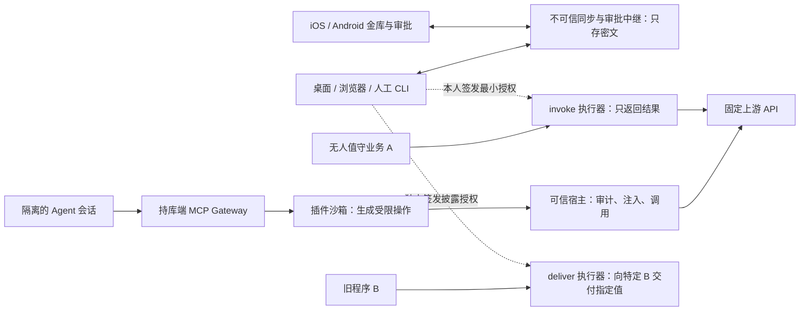

# Locklark：个人与小团队的本地密码管理器

**Keep the keys. Grant the action.** 钥匙留在你手里，Agent 得到的是执行这件事的许可。

产品名统一为 Locklark，仓库名和 CLI 均用 `locklark`。托盘图标方向是一只收起翅膀的云雀，翅膀的留白形成钥匙孔。

设计提案 · 2026-11-04。你的决定：新建独立 GitHub 项目；以现用 1Password 8 桌面日常体验为验收基准；金库本地持有；开发者继续使用 op 风格的字段引用；Agent 取用要写原因、关联会话，可以由 AI 拦下。产品形态参考 Magpie：桌面常驻、统一接入 Agent。范围包含完整 iOS/Android、本地 MCP 插件系统和两类独立部署的 server token（代执行、原值交付）；这两类机器协议不要求兼容 1Password。

建议先让 Windows 上的你可以连续用它工作，再补齐 macOS 和 Linux 各自实际具备的功能。版本基准是届时固定的 1Password 8.x 桌面版、配套浏览器扩展与 op v2。平台上没有的能力标为不适用；依赖网络服务的能力单列，不能把未实现写成已兼容。这里的「1:1」指用户和脚本看到的行为，不要求复制品牌、内部数据库或 1Password 7 的旧文件格式。

## 整套产品如何一起工作

一个独立 GitHub 项目，同一个本地金库模型，六个交付面：桌面与浏览器、iOS、Android、op 风格 CLI、可安装插件的 MCP Gateway、自托管服务。日常使用不依赖在线账号。本人在可信端建库、配对和签署授权；可选同步只传密文；需要无人值守时，只把选中的业务字段委托给独立执行器。



| 角色失陷 | 可能失去什么 | 必须仍然保住什么 |
| :--- | :--- | :--- |
| 同步/审批中继 root | 可拒绝服务、吞掉通知、观测流量或回放旧密文。 | 不得解库、签批准、改授权或读审计正文；保留独立恢复办法。 |
| Agent / invoke 业务调用方 | 可在有效授权内滥用特定动作，得知其合法业务结果。 | 不能导出字段、安装插件、任意改目标或借 deliver 身份取值。 |
| invoke 执行器 root | 可能窃取已委托给该执行器、调用上游时必须使用的凭据。 | 没有个人库主密码、Secret Key、整库密钥或 deliver 执行器的委托。 |
| deliver 执行器或旧程序 root | 可能获得明确授予这个环境的原值，已交付的静态值无法追回。 | 不能读取其他字段、个人库或 invoke 执行器的委托；泄露时在真实上游轮换。 |
| 已解锁的完整持库设备 | 其能解密的金库可能泄露。 | 撤销这台设备，换新库密钥并按泄露范围轮换上游；不能承诺保护已复制的旧快照。 |

新仓库建议按 apps/desktop、apps/ios、apps/android、apps/browser、cmd/cli、gateway、plugins、services/relay、services/team-directory、services/grant-status、services/invoke、services/deliver 和 conformance 组织。共享的是安全协议、数据模型、兼容向量和事件格式；移动端不直接移植桌面 UI。敏感服务分别发布和部署，不能因同一个仓库就共享密钥或宿主权限。

## 技术栈：Go 核心、Next.js Web、Bun 插件

Go 负责金库读写与导入、双密钥派生、设备与成员授权、审计、op 兼容 CLI、MCP Gateway、同步中继和两个机器执行器。各信任域仍是独立进程和发布包。KDBX 与密码算法调用成熟实现，以互操作样本和公开测试向量选库；KeePassXC 作为行为/格式参照，不把 C++/Qt 设为产品基础。桌面 GUI 用 MyGo（按所述 Go GUI 库采用 github.com/egoist/mygo），托盘、快捷键、窗口与 Go↔Web 界面通信归桌面宿主；MyGo 不承担密钥派生或插件隔离。版本在原型时锁定。

桌面默认用 MyGo 原生 GUI 做金库、快速搜索、托盘、解锁、批准和活动页，Go 宿主处理设备密钥与授权 IPC。Web 客户端用 Next.js + TypeScript；如复用非敏感的 Web 页面，仅加载随已签名桌面包分发的 Next.js 静态导出。主密码和 Secret Key 由 MyGo 的本机原生解锁窗口录入，不经 Next.js 页面或远程脚本；WebView 只绑定按窗口授权的窄接口。在线团队管理页使用 Next.js，但只处理中继状态与非秘密的管理信息，不解密金库、不直接签署成员/吊销决定。服务端动态下发的 JS 不可成为解锁入口。iOS 的系统凭证扩展用 Swift、Android 的凭证提供程序用 Kotlin，只保留必要的平台交互；共用 Go 的协议和测试向量，Go 移动绑定的扩展内存、启动时间和系统密钥访问要在真机验收。

插件使用 TypeScript 编写、由 Bun 构建并在独立 Bun 进程运行。包的签名覆盖编译产物、依赖锁和能力清单；运行时不在线安装代码。Go 宿主和 Bun 用有界的结构化 IPC 交换允许的操作和非秘密结果。Bun 可访问文件、网络和进程，语言运行时本身不构成沙箱；操作系统隔离必须实际阻断原始网络、任意文件、继承环境、进程启动和 FFI 旁路。无法证明隔离的平台不加载第三方 Bun 插件；移动端保留金库/审批功能，可调用已配对的可信网关。运行前用恶意测试插件尝试读取金库、启动 shell、外联和获取凭据。

工程依据：[MyGo GUI 官方说明](https://mygo.egoist.dev/)、[Next.js 静态导出](https://nextjs.org/docs/app/guides/static-exports)、[Bun 的 shell 能力](https://bun.com/docs/runtime/shell)、[Bun 文件 I/O](https://bun.com/docs/runtime/file-io)、[Go 移动绑定工具](https://pkg.go.dev/golang.org/x/mobile/cmd/gomobile)。

## 产品形态：像 Magpie 一样常驻，个人装好即可用

面向个人开发者和小团队。桌面常驻菜单栏/系统托盘；主窗口只有「金库」「待批准」「插件与 Agent」「活动」「团队」几个入口。托盘直接显示待批数量、当前工作区、金库锁定与 Gateway 状态，提供快速搜索和一键锁库。Agent 只连接一个本地入口。首次使用不需要服务器、Docker 或团队账号：建库、保存应急资料、导入本人选择的金库，即可离线使用。同步、共享和无人值守执行器按需添加。

个人第一次使用：安装 GitHub 插件 → 选择「仅查我指定仓库的 PR」模板 → 将它的凭据槽绑定到一个字段 → 选择允许接入的 Agent → 在活动页看到第一次调用。接入配置先预览并备份，只写自己拥有的片段，卸载时也只移除自己管理的内容。已有 op、MCP 配置和其它客户端可并行试用。

| 参考产品 | 借鉴的产品决定 | 在这里怎样落地 |
| :--- | :--- | :--- |
| Magpie | 常驻桌面，多个 Agent 共用一个本地入口，能管理不同客户端的配置。 | 托盘和移动待办是日常入口；本人选择给哪个 Agent 暴露哪套工具，不让配置文件包含真实 key。 |
| Docker MCP Toolkit / Gateway | 按 profile 组合服务器/工具并连接客户端。 | 提供「个人开发」「团队只读」「发布」工具集；工具集决定可发现性，逐次用钥仍独立裁决。 |
| MetaMCP | 把多个 MCP 服务组成命名空间，以统一端点接入。 | 个人和团队使用不同命名空间与身份；插件名称冲突时显示来源，不能用同名工具抢占权限。 |
| ToolHive | 隔离运行 MCP 服务，并降低接入现有客户端的成本。 | 内建受限插件默认无需容器；兼容需要进程/容器的外部 MCP 服务时，单独沙箱和最小授权，不注入整库密钥。 |

参考：[Magpie](https://github.com/yetone/magpie)、[Docker MCP Toolkit](https://docs.docker.com/ai/mcp-catalog-and-toolkit/toolkit/)、[MetaMCP](https://github.com/metatool-ai/metamcp)、[ToolHive](https://github.com/stacklok/toolhive)。

### 小团队共享和离职

每人拥有自己的双密钥账号和私有金库，团队工作区另设共享库，二者有独立库密钥。角色从简：所有者负责成员与高风险委托；维护者管理指定共享库、插件模板和日常审批；成员读取显式分享给自己的库或只被授予某些工具。机器身份单独登记。管理员不能因掌管同步服务器而读取个人库。用户拿到共享库的解密能力，就必须假定他能复制已共享的内容；只需“使用”而不应“看见”的人，用具名工具授权，不给库密钥。

邀请由现有所有者在可信端发起，核对新成员及其持库设备的公钥指纹后签署成员目录，只把当前库钥分别包裹给该成员已登记的持库设备，不发给账号级静态公钥；不接受仅由服务端指定的收件公钥。Agent 和机器的授权按库/字段、工具、目标、时间和负责人分开。团队活动只展示团队资源，个人活动对其他成员不可见；生产原值交付建议默认由两位不同的授权人批准，单人空间允许本人经过再认证单独签署。

成员离开：终止成员资格、移除设备/Agent、撤销其持有的机器授权与尚未兑付的批准；受影响共享库换新密钥代次并通知剩余设备。已共享过的上游凭据要单独轮换。团队可登记第二位所有者管理团队库；不能借“找回账号”解密个人库。验收用两人、两个个人库、一个团队库和一台机器，实际验证互不可见、加入、只用不读、离职和恢复。

团队用一个可信的成员目录排序端（可由所有者持有，独立于同步中继），只排序已获授权人签名的变更，不能解库、代签或自己加人。成员目录、有效设备、公钥包裹、共享库密钥代次和依赖成员资格的委托绑定为一次版本提交。两位所有者以同一父版本操作，只接受一个，另一个读取新状态重提。所有可同步库（包括个人多设备库）的发布都须先在可信排序端登记父版本、代次和密文摘要，收到签名认可后才能将对应密文交给不可信中继。无新鲜依据只存本机加密草稿；重连时确认仍是成员，再用最新代次加密。离职、离线改密和中继分叉并发必须实测，撤权前已经发布的版本不承诺追回。

## 找到了什么，应该用哪一部分

| 项目 | 能借什么 | 采用决定 |
| :--- | :--- | :--- |
| jihuayu/civault | Go + SQLite；密钥版本、策略、幂等、审计。GitHub Actions OIDC 的 resolve 路径在事务中检查授权、记审计，成功才返回值。管理 CLI 不提供 key get。 | 借鉴决策记录和失败处理；不把个人金库接进其服务端主密钥，不改造它的 CI 身份。 |
| KeePassXC / KeePassXC-Browser | 本地 KDBX 读写、附件、TOTP、浏览器配对、Passkey、系统快速解锁，以及 1PUX 导入，已有可运行实现。 | 作为行为和 KDBX 互操作的对照，产品以 Go + MyGo 实现桌面。先以合成库验证 Go 读写及迁移无损，不把更换语言等同于已达到 1:1。 |
| home-service/service-gateway 与 v-comment | 网关已有固定上游和具名 GitHub 只读动作。仓库自己的 v-comment CLI 要求先解锁 1Password SSH agent。 | 前者可作无明文执行的样例，后者是实际切换时的 SSH 验收场景。新项目不运行时依赖 home-service。 |
| secret-gate / Infisical Agent Vault | 前者把批准送到手机但仍依赖 1Password Connect；后者展示有期限的会话和代理注入，不是桌面个人密码库。 | 参考请求与执行流程，金库不放在它们里面。Infisical 旧独立仓库已建议新部署改用平台版。 |

证据：[CIVault README](https://github.com/jihuayu/civault/blob/eeb9485dd50617562a7239b7a0d44ea46a8d4a0b/README.md)、[实际 resolve](https://github.com/jihuayu/civault/blob/eeb9485dd50617562a7239b7a0d44ea46a8d4a0b/internal/vault/runtime.go)、[信封加密代码](https://github.com/jihuayu/civault/blob/eeb9485dd50617562a7239b7a0d44ea46a8d4a0b/internal/cryptobox/box.go)、[KeePassXC 手册](https://keepassxc.org/docs/KeePassXC_UserGuide)、[浏览器扩展](https://github.com/keepassxreboot/keepassxc-browser)、[本仓库网关](https://github.com/jihuayu/home-service/blob/3347ef74f1ad4f203b4f676bbcd06443351488be/apps/service-gateway/README.md)、[v-comment SSH 入口](https://github.com/jihuayu/home-service/blob/3347ef74f1ad4f203b4f676bbcd06443351488be/apps/v-comment/deploy/home-service/agent-cli.md)、[secret-gate](https://github.com/johnuopini/secret-gate)、[Infisical Agent Vault](https://infisical.com/docs/documentation/platform/agent-vault/overview)、[旧仓库说明](https://github.com/Infisical/agent-vault)。

## 桌面 1:1 如何验收：按任务对照

| 能力 | 必须完成的用户任务 | 对照方法 |
| :--- | :--- | :--- |
| 金库与条目 | 无需账号或联网即可首次建库、解锁、改密码；管理多库与集合，建立所有基准类别，增删改、跨库移动/复制、收藏、标签、排序和搜索。 | 同一份合成数据跑原版与替代品；逐项比较字段、顺序、关联、检索与锁库结果。 |
| 内容与生命周期 | 多个网站、分区、自定义字段、关联条目、备注、文件/文档、TOTP、密码生成、历史还原、归档、最近删除及恢复。 | 含中文、重复标题、空字段、多行私钥、附件和改名。归档条目不应再建议填充。原版导出没有的数据另列。 |
| 桌面交互 | 全局快捷入口、键盘搜索、复制指定字段、复制后清理、显示/遮蔽、空闲/睡眠/系统锁屏自动锁、系统解锁。 | Windows 验 Windows Hello、快捷键和多窗口；macOS 验 Touch ID、适用设备能力和 Universal Autofill；Linux 按桌面与权限机制实测。 |
| 浏览器与 Passkey | Chrome、Edge、Firefox；macOS 的 Safari 单列。保存新登录、更新旧密码、填 TOTP、身份/银行卡、生成密码、创建和使用 Passkey；桌面与扩展联动锁定。 | 在受控站点完成注册、登录、改密；对相似域名、跨来源 iframe、锁库后旧连接做负测。逐浏览器写结果，Safari 不用 Chromium 截图代验。 |
| 开发者工具 | 人工 op 风格 CLI、SSH Agent、Git SSH 签名；私钥只在本地完成签名。 | Unix socket 与 Windows OpenSSH 管道分别测；断网签名、锁库拒签、撤销后拒签。用仓库 CLI 的 SSH 依赖做迁移回归。 |
| 安全体检与联网能力 | 弱/重复密码、已泄露密码或受影响网站、缺少 2FA 等检查分项；跨设备同步、分享、Travel Mode 等用户可见入口另建清单。 | 本地可算项离线可用；需要外部数据的项目须明确数据源、隐私和更新时点。没有同等行为就标差异；自托管密文服务不能获得主密钥。 |

开工时生成 parity 清单：基准版本、OS、浏览器、动作、原版可观察结果、替代品证据、差异和阻碍。逐项标「未实现 / 已实现未对照 / 已实测 / 平台不适用 / 经用户确认的差异」。只有对照完成或明确接受的差异，才能打勾。这张表只验桌面；下文另订移动客户端、小团队共享、插件和机器能力的交付与验收。

基准资料：[桌面平台差异](https://support.1password.com/system-requirements/)、[Quick Access](https://support.1password.com/quick-access/)、[条目历史](https://support.1password.com/item-history/)、[浏览器与桌面连接](https://support.1password.com/1password-browser-connection-security/)、[Watchtower](https://support.1password.com/watchtower/)、[同步与离线访问](https://support.1password.com/sync/)、[SSH Agent](https://developer.1password.com/docs/ssh/agent/)。

## 双密钥与服务器失陷：哪些东西仍然安全

目标：即使攻击者获得同步、审批中继与备份服务器的 root 权限、全部配置、数据库、登录记录及历史快照，他也不应能读出金库、伪造一次用钥批准，或通过推送配置让客户端交出密钥。威胁模型假定用户的可信客户端、其系统密钥存储、独立发布签名和离线恢复材料未同时失陷。保密与可恢复分别验收。

以 1Password 的账号密码 + Secret Key 模式为基准：用户记住主密码，首台原生客户端用系统安全随机数生成独立的 Secret Key（至少 128 位随机熵），两者均不发给服务器。Secret Key 是参与加密的第二份秘密，登录短信或 TOTP 不能代替。已配对设备通过受系统保护的本地存储保管 Secret Key；新设备由本人输入应急资料，或和已有可信设备核对指纹后端到端迁移。审批专用设备只持有自己的签名私钥，不因能批准而得到 Secret Key。

密钥层次：两份秘密在客户端派生账户解锁密钥 AUK，解锁账户级材料；受设备保护的本地密钥槽须同时满足账户解锁和本机持钥，才能用该设备自己的收件私钥解封本代库钥。在线不保留仅凭 AUK 或账户通用私钥可开的库钥副本。审计加密、设备签名分别用不同密钥。v1 以官方白皮书 §8.2 的 2SKD 为派生基线：规范化主密码，按版本和独立盐处理口令与随机 Secret Key；如需账号口令认证，用独立派生的认证材料，不能拿 AUK 当登录凭据或上传单独的密码验证值。实现前固定参数、序列化、密钥用途和测试向量，用成熟密码库；不声称与 1Password 的账号协议或私有文件字节兼容。

KDBX 接入约束：给 KDBX 实现的开库材料是该库的高熵随机密钥，只在持库端解封并在内存交给成熟实现；文件层自身的 Argon2id 与账户层 2SKD 是两层不同机制。同步、迁移、导出、快速解锁和备份都不能保存只靠主密码可开的旁路副本、裸 keyfile、设备快速解锁封装或恢复包到服务器。服务器可保存密文、包裹后的密钥、公钥、盐、版本与路由所必需的最少元数据；文件尺寸或通信时间仍可能可见。

按主动攻击建模：只在独立签名的客户端输入主密码和 Secret Key；同步服务不下发可执行解锁网页或动态代码。更新签名私钥不得放在同步/中继服务器上，客户端独立校验发布签名、版本和最低安全参数。设备注册、接收公钥和授权策略必须有既有可信端认可；服务器替换公钥、追加设备、降级派生参数、篡改或回滚密文，要被设备签名、认证加密及已知版本检查拦下。只拿服务器快照初始化的新端没有可信最新版本依据，必须从已有设备或独立备份核对检查点，不能显示「已是最新」。

恢复与轮换：没有联网要求也能建库或还原自己有权解密的历史备份。应急资料在本地生成，包含 Secret Key、账户标识和恢复指引；主密码分开保管。独立备份包含公开派生参数、密文及同时要求账户解锁和独立离线恢复材料的备份信封。双密钥不能取代在册设备或当前离线恢复材料。服务端删除或返回空库不能触发客户端清空本地数据。所有设备、备份或必要的解锁材料都丢失时，管理员无法恢复。修改主密码/再生成 Secret Key 需要可信端重新包裹密钥并更新应急资料；不能让之前被复制的可解密快照失效。若怀疑条目已泄露，还需在对应服务轮换真实凭据。

公开依据：[1Password 安全白皮书 §8.2](https://1passwordstatic.com/files/security/1password-white-paper.pdf)、[Secret Key 说明](https://support.1password.com/secret-key-security/)、[Emergency Kit](https://support.1password.com/emergency-kit/)。这是本项目的设计目标，不是既有实现的安全结论。

### 上线前必须演练的三次事故

| 给攻击者什么 | 合格结果 |
| :--- | :--- |
| 整台服务的镜像、磁盘、备份、日志、TLS 私钥和已知的正确主密码；没有用户 Secret Key/可信终端。 | 不能解密合成标记，不能单靠服务器材料验证主密码猜测；反向测试只给 Secret Key 和密文也不能直接解锁，但弱主密码仍可能被离线猜出。审查所有恢复、登录和缓存路径，不能把一次解密失败当安全证明。 |
| 让控制服务器的一方主动替换公钥、重放旧库、改 KDF 参数、发伪造更新或伪造 Agent 批准。 | 已登记客户端拒绝或明确报告无法证实新鲜性；不解密、不执行、不覆盖最后可信版本。无中继仍可离线使用个人金库。 |
| 清空整个服务器并断开原设备；在干净电脑使用独立加密备份、账户双密钥和与该备份代次匹配的离线恢复材料。 | 恢复条目、附件、引用和审计正文，按 session 查回已拒绝、已披露与结果未知；用历史验签公钥及独立检查点核对时间和末尾缺口，旧设备身份、会话和 Agent 批准全部失效；只能承诺恢复到最后一份可核实备份，不能承诺丢盘前未备份的新写入。 |

在使用真实金库前，以合成数据完成测试向量、故障演练和独立密码设计/实现评审；记录仍然可见的元数据和未覆盖平台，再判定是否达到上述目标。

## 成员与设备吊销：交给它新版密文，也打不开

安全目标从吊销生效的代次开始：给攻击者旧设备完整磁盘、旧设备私钥、所有旧金库密钥，甚至正确的主密码和原 Secret Key，再交付新快照、全部在线设备信封、附件及同步服务器备份，它都不应解出新代次内容。单设备吊销只排除该设备；成员移除排除其所有设备。已经看过的明文、已复制的旧快照或已披露业务 token 无法收回。

每台持库设备独立生成用于收钥的密钥对，并用另一把密钥签名；私钥不从账户双密钥派生，也不跨设备同步、克隆或随普通备份还原。每库每代生成独立随机库钥。可信端只为该代仍获准的设备公钥分别制作密钥信封；信封绑定工作区、库、代次、接收设备和签名成员目录。可使用标准 [HPKE](https://www.rfc-editor.org/rfc/rfc9180.html) 实现收件加密；设备授权与目录签名另行验证。AUK 用于本地账户解锁，不能凭它或同账号通用私钥从在线快照打开任意代次。输入正确双密钥也不能把旧设备、克隆或自报的新公钥重新登记。

| 吊销步骤 | 系统必须怎么做 |
| :--- | :--- |
| 1. 移出并冻结旧代 | 可信目录排序端在同一串行版本上接受已授权的吊销。移除设备时保留本人其他已登记设备；移除成员时排除其全部设备及依赖该资格的会话/授权。立即停止承认旧代新发布；离线编辑只留加密草稿。界面显示「已阻止新发布，换钥中」。 |
| 2. 重新加密 | 仍获准且能打开旧库的可信设备生成全新随机库钥，不由旧钥派生。用新钥重写整份当前快照，包括未改动的条目、保留历史、附件、索引及同步增量；独立分块存储的内容也必须换内容密钥并重加密，不能只换文件头或复用旧密文块。与该库共享相同访问边界的审计详情改用新代次。 |
| 3. 发布新代 | 一次提交签名新目录、状态版本、新快照摘要及仅面向剩余设备的信封；待处理的旧批准作废。恢复的客户端和执行器必须核验当前签名头，不回退旧代或把新数据投递给旧委托。完成后显示「新代已生效」。重写中断或没有可信设备/独立恢复材料，持续冻结而非虚报完成；总吊销进度按受影响的库分别展示。 |

恢复不能成为侧门。在线快照不得附账户级、旧成员级或旧应急包可解出的通用信封。独立灾备使用另行保管的离线恢复材料；吊销换代时为新代建立未向被吊销方开放的恢复路径，旧应急材料即使被保留也不能打开新代备份。团队备份由团队恢复保管人保护，不为离职成员保留个人恢复信封。灾后恢复历史备份不等于重新入组；接入当前团队仍须经过当前可信目录。若最后一个可解库设备丢失且没有独立可用的恢复材料，就不能承诺恢复。

保留每份设备登记、审批角色和机器委托的签发设备、签名者及授权来源。吊销时冻结仅靠被吊销设备背书的登记和全部派生权限；来源不明也冻结。另一台独立且未受影响的可信设备或所有者，核对真实设备与接收人后才能重新授予。不能把受影响设备提前登记的影子设备当作无关设备保留。库换代后，旧设备/成员不能凭原先登记的 Gateway 会话、机器 grant、服务器 token 或“跟随最新”配置取回新字段；要继续委托给合法机器，须由当前获准的持库端按新代次和当前目录重新封装。如果旧设备曾有机器工作负载的私钥/接收身份，还须重新登记机器身份并作废旧凭证。既往原值已经交付或属于共享网站账号时，另行轮换上游凭据。

离线验收：同一成员有手机 A 和经独立背书的电脑 B，另一成员有设备 C。先让三台打开第 7 代并完整保留旧材料。吊销 A，用 B 发布第 8 代；把第 8 代快照、新附件、全部信封和备份复制给断网的 A，只用本地解密工具验证 A 失败、B/C 成功，同时确认 A 仍可读它已保存的第 7 代。再移除 C 所属成员（含该成员的第二台设备），重复验证：两台都失败；保留成员的新设备须独立获批才成功。额外测试改收件公钥、用双密钥自行重新注册、重放旧索引、复用旧块、换钥崩溃、恶意中继分叉，以及任何旧委托不能领到新版本。另让 A 在吊销前单独登记影子设备 X、签出跟随最新的 deliver 授权；吊销 A 后两者都应冻结，不能收到新代库钥或新字段。让恶意中继对离线的 B 回放第 7 代，B 新改的密码只能成为本机草稿，绝不能加到第 7 代并上传。

## 金库、字段与迁移

逻辑模型按 1Password：本地 Profile（对应 account 选择上下文）→ Vault → Item；Item 有 category、title、urls、tags、favorite、sections、fields、files、references 与 revision。字段有稳定 id、label、type、purpose、value；自定义区段保留顺序。用户名/密码、OTP 种子、SSH 私钥、文档、Passkey 都有明确类型与披露规则，不能统一降成字符串。保留可获得的源 ID，为无 ID 的对象分配稳定 ID，并记录映射。

建议每个逻辑 Vault 对应一个独立加密 KDBX 4 文件，用从当前设备专属信封解出的本代随机库钥打开，文件层使用成熟的 Argon2id 实现；在密文内保存版本化的条目布局和稳定字段 ID，标准字段、附件和历史尽量使用原生槽位，避免两处写同一个值。不能表达的内容要有无损扩展或阻止切换。一个用户交互进程拥有已解锁金库；扩展、CLI、Agent 都经鉴别后的接口访问。搜索索引仅在解锁时存在或随库加密。生物识别只解封本设备授权，忘记主密码不靠服务器重设。

接受 op://vault/item/field 与 op://vault/item/section/field，支持名称与可用 ID；同名导致歧义就报错，不猜第一项。以固定 op 版本对照转义、查询属性、OTP、附件与错误；未实现属性明确报错。建立/编辑的条目也保持相同布局。[条目模板](https://developer.1password.com/docs/cli/item-template-json/) · [引用语法](https://developer.1password.com/docs/cli/secret-references/) · [KDBX 4](https://keepass.info/help/kb/kdbx_4.html)。

迁移采取只读源 → 本机预检 → 新建加密目标 → 对账 → 双轨使用 → 切换。1PUX 是明文归档，只选用户指定的本地文件，不上传、不进入日志；限制归档大小和路径，默认不解压到临时目录。预检输出类别、数量、引用、附件、缺失和不可映射项；用合成数据核对字段及附件内容、重复导入幂等、崩溃不覆盖原库。停用旧库前必须在干净机器恢复加密备份；还应能用明确授权的本地导出来验证可迁出。

双轨期间只让 1Password 写，新端只读试用；不能两边同时改密码。切换窗口暂停编辑，按每个账户/库重新导出并对账新增、修改、归档和删除，用稳定 ID 和修订信息核对，缺失项由本人判定，不默默删除。只有本机逐库核对、关键站点在新端独立登录、无未解释的凭据/附件缺失，才把写入权交给新端。保留旧库只读。如果切换后要回退，先暂停新写入，核对切换后变化并由本人回填旧库，再恢复旧库写入，不直接用旧备份覆盖。

Passkey 单独办理：桌面 1PUX 不能导出已有 Passkey。移动端 Credential Exchange 要求目标应用也支持接收；完整手机端将实现并实测支持平台的凭据交换；审批专用模式不接收。不能交换的条目逐站新建 Passkey、从新端实际登录，再决定是否移除旧凭据。历史按导出实际提供的内容迁移，不声称完整复制服务端历史。[1PUX 结构](https://support.1password.com/1pux-format/) · [官方导出限制](https://support.1password.com/export/)。

## 两个命令入口，共用一个本地金库

人工模式：CLI 以 locklark 安装，提供可选 op 兼容入口。首先对照 vault/item/document 的日常操作，以及 read、run、inject 的输入、stdout 字节、JSON、退出状态、锁定行为；再按官方命令清单列差。可在隔离的终端显式切换，不覆盖现用 op。人工按需读取明文；人类入口只接受配对的可信本地客户端和相应解锁/交互，Agent 不能通过换个命令名成为人类。[op 命令参考](https://developer.1password.com/docs/cli/reference/)。

Agent 模式：使用 locklark CLI 提交用钥请求。每次请求都绑定会话、原因、字段、动作和目标。默认执行动作，只返回业务结果。人类 op read / op run 的披露语义不能偷偷改成「返回请求号」；兼容命令与新 Agent 命令的退出协议分开。首个通路做 github.pulls.get；第二个用会话专属 SSH 连接器访问指定 NAS，核验主机密钥，只允许本次会话使用指定钥匙，不转发通用 SSH agent。受管 Agent 没有 raw read、--reveal 或任意 shell 注入权限。需要原值的旧程序使用独立部署的机器 deliver 授权，不能用 Agent 会话或 MCP 工具替代。人工 op read 保持其明确的披露语义。

## 一个远程请求，从提交到用完

```sh
# Agent：由受信启动器登记的会话；命令和 ID 均为示例
locklark use "op://工作/GitHub/token" --session s_42 --reason "确认 PR 363 的合并状态" --action github.pulls.get --repo jihuayu/home-service --pr 363
# 需要你决定时：{"status":"pending","request_id":"r_73","expires_in":86400}
# 重连或重开 CLI，使用原会话的身份：
locklark request resume r_73 --session s_42
# 本人查看会话用钥记录（无秘密值）：
locklark audit list --session s_42
```

请求先持久化再通知。手机或第二台电脑的已配对审批器显示：哪台机器、哪个 Agent/会话、哪个库/字段、它自己写的理由、系统验证的目标、会做什么、是否给出原值、有效期。可批准一次、拒绝或撤销；通知不带原因/密钥，也不包含一键批准凭证。错过通知仍在待办，原 Agent 退出后可恢复；到期只能重提，不默许。建议待办 24 小时，批准只给短窗口（例如 2 分钟）、一个动作、一次兑换。

批准设备签名绑定请求摘要（Agent 身份、会话、指定持库设备、字段稳定 ID 和版本、动作及精确参数摘要、有效期、nonce）；中继只转交加密信封，不能批准、解库或冒充设备。持库端若尚未解析引用或核定动作，待办显示「等待持库端核实」，此时不能批准；已核实的请求可在手机处理。批准不等于解锁，持库端锁定或离线都不执行。首版每张请求绑定一个执行设备，不能用另一台重兑；切换执行设备必须重提。批准与撤销都要在指定持库端入账；持库端按有效期、设备登记和最新本地状态原子裁决。手机可签一次后离线；待办明确区分「已发出」和「持库端已接受/已撤销」。网络分区期间不承诺撤销即时到达；最长暴露窗口由短效批准限制，过期重提。已执行的签名或已披露原值不能撤回。恢复旧备份须变更执行代次，使恢复前的批准全部失效。

会话编号是查账索引，不是凭证。本人首次配对可信启动器/运行环境；启动器在 Agent 之外为每次 run 签发并保管独立的会话身份，将可验证的外部 Codex 会话 ID 与本地会话关联。自行填写的 thread 名和理由标「自述」。拿不到可靠外部 ID，只展示本系统已认证的 run，不冒认某条聊天。

远程 Agent 首版必须在独立 OS 用户、虚拟机或远端 runner 中运行，只能访问会话专属连接。金库文件、桌面 IPC、浏览器 native messaging、人工 SSH 管道、剪贴板及 UI 自动化均不对它开放。Windows 上与本人共用完整桌面权限的 Codex 不能证明没有旁路，因此拒绝启用“所有用钥必经审批”的受管模式；不能靠检测进程名或换 CLI 名称来区分人和 Agent。用真实攻击夹具尝试调用人工 CLI、读取持库进程、签名管道和模拟批准，作为启用前置。

## 移动端：完整金库、系统填充与远程审批

iOS 与 Android 都交付两种明确的配对方式。完整金库模式须验证账户解锁资格，并由现有可信端把这台设备的新公钥加入当前目录；双密钥不能独自恢复已吊销资格。加入后可离线解锁、搜索、增改、生成密码、显示 TOTP、使用附件与历史。仅审批模式没有 Secret Key、金库密钥或条目列表，只能读发给此设备的加密请求摘要并签署决定；升级为完整模式必须重新配对，不能靠服务端改一个角色。手机对标移动版的日常工作流，另建版本/系统能力矩阵。

| 工作流 | iOS 与 Android 的实现边界 | 实机验收 |
| :--- | :--- | :--- |
| 登录与填充 | iOS 用 AuthenticationServices 凭证提供程序扩展；Android 用 Credential Manager 凭证提供程序，并为对应表单做 AutofillService。扩展每次向受保护本地存储申请最小所需记录，按域名/RP ID 或经核验的应用标识匹配。 | 真实浏览器和第三方 App 保存、改密、填充、TOTP 与 Passkey 注册/登录；相似域名、错误 App 绑定、锁库和撤销后拒绝。 |
| 解锁与离线 | iOS Keychain/可用硬件保护和 Android Keystore 保管设备密钥；可选生物识别只重新解封本设备授权。排除系统云备份中的 Secret Key、设备私钥和快速解锁材料。 | 飞行模式可开库、编辑和填充；重启及系统锁后重新认证。安装到第二台机器不应移植原设备身份。 |
| 远程待办 | 推送只有随机通知标识；App 拉取、解密并验证请求签名，展示自述、核实目标与是否披露原值。本人验证后签一次；默认不会授予持续权限。 | 通知关闭、失联、应用被系统结束后从待办重开；显示本地已签、对端已收到及已执行三个状态，不因静默推送失败丢单。 |
| 凭据迁移 | 完整模式按平台支持接入 Credential Exchange 的接收/导出；导入先预检并报告不可映射项，审批专用模式不接收凭据。 | 用实际支持的来源 App 转移测试 Passkey，再独立登录测试站点；不能交换的条目逐站重建，不假设所有 OS/浏览器都有该能力。 |

多端写入：个人多设备库也须经本人的可信目录排序端核验当前设备与代次，可以由指定的本人设备承担，不需要云账号。没有可信的新鲜状态，任何库都只保存本机草稿；同步中继的条件写入只用于传输冲突检测，不是授权证明。只有当前目录接受父修订、密钥代次和密文摘要，才把签名后的加密快照/变更包交给中继。不同条目可由可信端合并；同一字段并发编辑、删除与编辑并发要保留两版并提示本人选择，不用服务器时间挑赢家。同步恢复时核对签名设备目录和已知检查点。撤销丢失设备后，更新设备目录与受影响库的密钥代次，只把新密钥发给剩余设备；不假设能抹掉丢失设备已持有的明文。

移动端作为审批器，不作为保证全天在线的服务器。电脑关机时，只有事先单独配置、在线且具备对应委托的执行器才能跑任务；未委托则保持待处理。平台依据：[Apple 凭证提供程序](https://developer.apple.com/documentation/authenticationservices/ascredentialproviderviewcontroller)、[Apple 凭据交换](https://developer.apple.com/documentation/authenticationservices/ascredentialimportmanager)、[Android 凭证提供程序](https://developer.android.com/identity/sign-in/credential-provider)、[Android 自动填充](https://developer.android.com/identity/autofill/autofill-services)、[Android 凭据交换](https://developer.android.com/identity/sign-in/credential-transfer)。

## MCP Gateway 是插件系统

Gateway 是本地客户端的宿主，也可随 invoke 执行器跑一个受限实例。一个插件提供一组具名 MCP 工具、输入/输出 schema、受审核的上游动作和所需凭据槽。Agent 发现和调用工具；安装、更新、授权、获取凭据是四种独立权限。宿主依据已认证会话过滤可见工具且每次调用都重新授权；MCP 工具注解或插件自称只读不构成权限。

```text
# 合成插件清单（示意）；签名覆盖清单与模块摘要
id: github.pull-reader
version: 1.0.0
tool: github_pulls_get
action: github.pulls.get
input: { repo: repository_id, number: positive_integer }
credential_slot: github_read
request: { origin: "https://api.github.com", method: GET, route: "/repos/{owner}/{repo}/pulls/{number}" }
output_fields: [number, state, merged_at]
```

安装：只在解锁的所有者客户端安装。核验包签名、发布者和版本摘要，展示“允许联系谁、能做哪些动作、返回哪些字段”；本人将槽绑定到某库某字段，并限定仓库/账号。安装不授予槽；绑定不授予任何 Agent。升级后包摘要变化须按策略重新认可；新增出口/字段/动作必须重授权。停用或撤销立即停止新调用，已发出的请求单独记账。插件目录可自托管；目录失陷不能替换已批准的包。

接入方式：本机用 stdio 桥接到受限 IPC（Windows 管道或 Unix socket），由可信启动器认证会话；绑定 loopback 不是身份认证。跨机连接要求 TLS、指定受众和配对身份，所有端点仍按工具重新授权。第三方 MCP 插件只能拿到明示许可的业务信息；允许已有 MCP 进程不等于授权它继承桌面环境或读取金库。

SSH 插件从本地签名到远端执行都限定为 NAS 上独立低权账号的具名命令。双方校验命令/参数，远端用强制命令和专用账号约束；禁交互 shell、PTY、SFTP、任意文件读取、端口和 agent 转发。命令只返回白名单业务字段，该账号不能接触 deliver 服务、套接字、业务环境或凭据文件。验收要在正确主机上实际尝试越权命令、隧道和读取合成凭据。人工 SSH 客户端的兼容路径与此分开。

运行：每个 Bun 插件在与 Go 宿主分开的受限进程执行。通过操作系统沙箱限制文件、网络、环境、剪贴板、FFI 和创建子进程，不能依赖 Bun 或 TypeScript 自律。插件只构造类型化操作，不能持有原值或生成任意带认证请求。可信宿主独立解析固定目标、方法、范围和参数，拒绝重定向、未允许的网络地址与回显认证头的端点，注入字段后只和已核验的上游通信。只返回许可的结构化业务字段；出错不回传请求头、上游原始文本或任意 URL。第三方上游若充当 MCP 服务，须有专属上游身份；不把 Agent 提供给 Gateway 的登录令牌转发过去。

调用例：Agent 以已配对的会话对 tools/call 调 github_pulls_get(repo, number, reason)。Gateway 创建持久 request_id；需要人工时返回 pending 和可继续查询的请求号；重连凭原会话恢复同一请求，不生成第二次调用。本人在手机批准后，宿主只返回 PR 状态。未知工具、未授权字段、恶意插件、回显或策略失效都拒绝；Gateway 没有 get_secret、通用 HTTP 或 shell 工具，也不降级为返回 token。

审计串联 MCP 调用 ID、会话/机器主体、插件发布者/版本/摘要、授权版本、动作及经核验的上游目标。验收插件越权取槽、诱导改主机、绕过网络沙箱、恶意升级、输出注入、断网重试与紧急停用；在工具输入输出、Agent 日志和中继中均找不到合成原值。[MCP 工具规范](https://modelcontextprotocol.io/specification/2025-11-25/server/tools) · [MCP 安全实践](https://modelcontextprotocol.io/specification/2025-11-25/basic/security_best_practices)。

## Server token：操作权与原值交付分开

两种能力都交付，但不能共用 token 或部署边界。server token 是业务机器的调用凭证，不是 Secret Key、金库解锁密钥或可以离线打开个人金库的密码。协议采用本项目的版本与错误契约，不要求兼容 1Password Service Accounts。个人不需要无人值守任务时不必安装任何执行器。

|  | invoke：代执行 | deliver：受控原值交付 |
| :--- | :--- | :--- |
| 典型任务 | 定时查询 GitHub PR 或发布检查，只需结果。 | 遗留数据库客户端启动时必须获得某个连接密码。 |
| 签发时固定 | 工作负载身份、invoke audience、唯一执行器、工作区、插件版本、动作、资源上限、次数/到期时间。 | 独立工作负载身份、deliver audience、唯一执行器、字段 ID 与版本策略、允许接收的公钥、用途、次数/到期时间。 |
| 调用方得到 | 经输出 schema 筛选的业务结果。没有读字段接口。 | 仅获授权的那一个字段；端到端交付给登记的业务进程/sidecar，明确标记已披露或交付未知。 |
| 独立部署 | 专属服务、主机/VM、密钥、存储、网络和上游连接；无披露 API。 | 另一安全域中的专属服务、主机/VM、密钥和存储；不加载 Agent 插件，没有通往个人库的通用读取入口。 |
| 泄露后 | 窃取调用方凭证可能滥用获准动作；攻破执行器可能暴露其受托的字段。 | 窃取接收端可能取得该端已经领到的值；撤销阻止新交付，实际服务必须轮换已知值。 |

### 签发、运行、轮换、撤销

1．配对。所有者在解锁的可信客户端登记工作负载证明公钥和指定执行器公钥；通过独立渠道核对指纹。明确拒绝把同步服务器当执行器、把两个执行器放在同一管理员/root 安全域，或让受管 Agent 共用 deliver 工作负载的本地权限。个人没有独立安全域时只启用他实际能隔离的能力，不以两个容器冒充隔离。

2．签发。有权限的人选择工作区、固定字段和模式，预览“谁能用、能不能看到原值”，在客户端签署不可扩权的委托。客户端对执行器公钥加密仅包含所选字段/版本的最小材料包，绑定 grant、用途、有效期和执行器，绝不传个人库解锁材料。另生成至少 256 位随机的不透明调用凭证，只向指定工作负载显示/交付一次；执行器保管验证值，调用还必须通过绑定工作负载证书的 mTLS。两类 token 有不同受众、验证库与路由，不可互换。

3．无人值守。所有者可为低风险操作建立有期限的常设授权。可信执行器有已委托的最小材料，金库电脑和手机都离线仍可在授权窗口内工作。每次重验工作负载、受众、签名委托、字段版本、限额、到期与撤销，再持久记账。建议机器授权默认 7 天，短效撤销状态租期最多 5 分钟：单独配置的可信授权状态端只在所有者签署上限内续发；执行器联系不上状态端时最多用到当前租期结束。高风险调用若规则要求人工且无人在线，保持 pending 或超时拒绝；不把无人值守等同自动放行。

授权状态服务在可信边界，使用固定公钥和独立直达地址；两种模式用独立验证域/签名钥。它只为已有、未过期的所有者签名委托证明当前状态，不能解封材料包、改变动作/收件人或扩大到期时间。租期含委托 ID、代次、递增状态序号和截止时间，执行器拒绝回退；状态服务灾后恢复先冻结续签，验证独立检查点与撤销账本后再启用。五分钟上界从可信状态端签收撤销起算；如果中继吞件且本人没有通过直达途径取到回执，最坏可持续到整份委托到期，不能显示“已撤销”。

4．交付。invoke 将凭据注入固定上游。deliver 只把选定字段加密给工作负载已证明的本次接收公钥；所有者的授权锁定接收身份，挑战、请求、尝试号和密文摘要一并绑定。接收端签回执后记「确认收到」，断线只记「交付未知」。遗留程序优先通过受限本机 socket/文件描述符消费，不打到命令行、日志或 Agent 环境。可信接收端取得明文以后，本系统不能证明其后续用途。

5．轮换与撤销。默认固定字段版本，轮换后旧委托拒绝。可显式授权跟随同一字段的新版本；新材料仍须由可信持库端重新封装，未投递时显示版本待同步，不回退旧值。调用 token 可短期双轨轮换后撤销旧凭证；撤销显示本地已签、状态端已接受、执行器已生效。撤销到达前有短效租期窗口；已披露原值必须在实际服务轮换。需要换执行器则重新配对、封装并废止旧委托，不复制机器私钥。

```text
# 本人签发（命令示意，凭证写入已配对工作负载，不上屏）
locklark machine grant create --mode invoke --workload ci-reader --tool github_pulls_get --repo team/app --expires 7d
locklark machine grant create --mode deliver --workload old-db-client --field-id fld_db --recipient db-host --expires 1d
# 不同主机和 audience，调用均需 token + 配对身份
POST invoke-host/v1/operations           -> 业务结果 / pending(request_id)
POST deliver-host/v1/deliveries          -> 指定收件人可解密的信封
POST deliver-host/v1/deliveries/:id/ack  -> 绑定该次交付的签名回执
```

两个服务都要求稳定幂等键，同键不同动作/收件人拒绝；扣配额、占用授权、写执行意图同一事务。结果未知不自动重放，尤其不能把披露给另一接收端当重试。本人能在活动页按机器/委托追到原因、插件/字段版本和结果，不记录 token 或其可复用派生物。验收：用 invoke token 调 deliver、把证书换机器、替换收件人、并行重兑、断网过租期、篡改日志、隔离其中一台 root 均做负测；以合成凭据验证受影响范围。

## AI 到底可以决定什么

| 发生了什么 | 系统决定 | 例子 |
| :--- | :--- | :--- |
| 确定越权、已撤销、目标不在白名单 | 硬拒绝；人工和 AI 都不能在这张请求上扩大权限。 | 理由说查 PR，实际动作是发布或发往其他主机。 |
| 落在已有授权内，风险低 | 仅由用户事先写下的窄规则放行；AI 可以收紧、转人工或否决。 | 测试库的只读 key，只查指定仓库的 PR 元数据。 |
| 生产凭据、敏感动作或缺少授予 | 可申请范围内必须人工逐次批准；没有可申请资格则拒绝。AI 的「看起来合理」不能越过这条线。 | 同样是查状态，生产管理员凭据不能代替测试 key。 |
| AI 判定理由与动作不符、疑似注入 | 可按用户设置拒绝本次或转人工；记录简短理由码、模型/策略版本。误拒可由本人查账并重新发起，不重开硬拒绝。 | 网页让 Agent 读另一个库并把 key 贴回网页。 |
| AI 不可用、无效输出或超时 | 依赖 AI 评估的策略转人工或拒绝；不把异常当成通过。 | 断网仍能用本地密码库；受影响的是自动评估。 |

送 AI 的只有脱敏后的任务摘要、动作、目标分类和策略标签；默认不发完整聊天、字段值、OTP、命令输出或任意网页正文。用本地模型或显式启用的外部模型，结构化输出限于拦截/复核/无异议，模型没有取钥、改策略或审批的工具。

## 用钥活动与审计：首版必备

按 request_id 串联 requested、policy_decided、human_approved/denied、execution_started、succeeded/failed/outcome_unknown、expired/revoked 等事实。记录可信设备与 session、脱敏理由、字段版本、目标动作、策略和模型版本、审批签名及结果；拒绝、超时、未执行都能按 session 或条目反查。详细理由和审计存在本机加密存储，普通日志只含最少标识；不记录原值、密钥摘要、环境或上游响应正文。

交互 Agent 的最终执行权在持库端；已委托的业务机器请求则由对应的 invoke 或 deliver 执行器裁决，在该执行器写本地审计后才能使用字段，不能以同步中继或状态端的日志代替。兑换前重查版本、锁定/撤销、会话签名和批准摘要，原子占用一次性授权并提交执行意图；审计不可写就不使用。指定适配器固定方法、源站、仓库和参数，禁任意 URL/重定向并只回传选定业务字段。上游超时或执行后崩溃标记结果未知，不自动重放；查询 PR 成功能证明执行过读取，SSH 签名成功只能证明签过，不能推断对端登录成功。人工 raw read 只能证明已披露，不能证明后来在哪里用过。

审批器用首次当面配对（扫码并核对双方指纹）的设备密钥签名，私钥保存在系统安全存储；中继仅负责持久存放密文和送达通知。手机丢失在持库端解除配对，作废该设备未消费的批准。只有本人本机可变更策略；批准用途、显示明文和解锁金库是三个不同权限。

针对恶意中继吞件：启动器/审批器先在本机写签名发件记录，经端到端加密中继；持库端返回绑定请求的签名回执。恢复连接后按发件序号、回执对账，区分未送达、已受理和无法核实，没有端点证据不声称拥有全量历史。授权处理与日志读取分开；锁库时允许写入仅本人可解密的最小待办/拒绝信封，不能借记账解锁金库。

独立备份还包含加密审计正文、受账户双密钥和独立备份代次恢复材料保护的审计密钥、历史验签公钥/设备目录和已见证检查点。灾后重建使用新的设备身份与代次；历史公钥只能验旧记录，不能恢复旧设备签名能力、待兑批准、旧会话或机器可执行授权。新实例不能未经核对把旧状态当作当前授权。

### 你能直接查到什么

桌面提供「活动」入口；每个条目可看它的使用历史，每条 Agent 会话可看它申请过的已受理的字段，并能对照启动器的未送达申请。列表按时间、设备、Agent、外部会话、稳定条目/字段 ID、动作和结局筛选。请求详情明确分列「Agent 自述」「系统核实」「规则/AI 的决定」「本人批准」「持库端实际执行」。被拒绝、只批准未执行、已向人工/业务进程披露原值和执行结果未知都可单独筛选；条目改名、轮换或删除后，仍能追到当时版本。

```text
locklark audit list --session s_42
locklark audit list --field-id fld_gh --outcome denied
locklark audit show r_73
# 合成时间线（香港时间）；同一个请求，未向 Agent 披露原值
09:12  Agent 请求：会话 s_42；原因「确认 PR 363 的合并状态」
09:12  持库端核实：github.pulls.get；目标 jihuayu/home-service#363；字段 fld_gh 版本 7
09:12  策略 v4 要求本人批准；AI 建议：转人工（生产库）
11:36  已配对手机签署「只准这一次」；批准已到达持库端
11:36  持库端保留本次执行并发出请求；收到上游成功回执
11:36  结果：读取成功；给 Agent 的是 PR 状态，未交付 token
```

除了 Agent 取用，还记录人工 CLI 披露/注入、桌面复制、浏览器填充、SSH/Passkey 签名、导出、设备配对/撤销、策略/密钥变更、恢复和审计导出。人工动作标本地会话，不伪造 Agent 原因；浏览器填充不证明用户登录成功。无完整因果链就显示证据缺失，不能把没有记录解释为没有发生。

### 日志本身如何保护

每台持库设备维护本地加密、只追加的审计账本；事件含 schema 版本、唯一事件 ID、设备序号、UTC 时间（显示时转本地）、request/session/attempt 的关联和经核验的结果来源。按设备序号和签名前序摘要检错；不同设备以请求和签名关联，不假定钟表完全同步。定期把签名检查点存到另一台可信设备或独立离线介质；本地链可发现被改写的中间记录，独立检查点才能揭示整段历史回滚，未见证的末尾截断不能保证可查。

金库值、密码、Secret Key、OTP、私钥、认证头、命令环境、响应正文和全文聊天不入账。原因按结构化用途与限长说明收集；疑似粘入的凭据在持久化和送 AI 前拒收或遮蔽，签名记的是最终脱敏内容。本人解锁后可查全部记录；Agent 只见本会话回执。默认不上传审计明细，排障遥测只用脱敏标识。默认不静默清理历史；本人可导出脱敏报告、归档加密账本，清理须留下时间区间、操作者与签名检查点。

执行意图写不进本地账本时，不签名、不披露、不向上游发请求；拒绝用钥不能妨碍锁库或停用设备。外部日志服务断网不影响本地记账。若上游已收到请求而本地没来得及记结果，恢复后显示「结果未知」，不能自动再试。原值披露区分「开始发送」与「调用端确认收到」，断线不能写成确认交付。

故障验收：模拟磁盘满、掉电、重复请求、回执丢失、时钟回拨、还原旧账本与篡改记录；确认未记录意图就没有外部调用、同一批准不会重用、失去证据不会显示成功、独立检查点能揭示回滚。用合成秘密扫描日志、报告及中继载荷，拒绝与成功都要能由本人按会话查回。

## 落地顺序与切换条件

| 里程碑 | 交付物 | 通过条件 |
| :--- | :--- | :--- |
| M0 兼容性原型 | 基准矩阵、双密钥威胁模型与向量、审计事件契约、合成 1PUX 与 KDBX 映射报告。 | 验证 MyGo 原生桌面与 Next.js Web 的安全边界、Bun 逃逸负测和设备吊销离线解密矩阵；在 Windows 做「导入→改名/改字段→保存→重开→引用→导出」对照，覆盖复杂区段、重名、附件和 TOTP。无损性未证明就不锁定底座。 |
| M1 个人桌面可日用 | 本地金库、完整条目模型、Quick Access、系统锁、备份恢复、首批浏览器与人工 CLI。 | 通过服务器失陷三场演练及独立密码评审；本人能离线查用钥活动；拔网首次建库、读写、填充、解锁；同一合成库通过旧版 op 与替代 CLI 的输出契约；真实 Windows 浏览器和 SSH 管道通过。 |
| M2 Agent 远程授权 | 桌面持库端、配对审批端、持久待办、AI 否决、审计及 github.pulls.get 首个适配器。 | 错过通知数小时仍可批、重启后可恢复、并发只兑一次；篡改目标/版本、设备串用、冒认会话均被拒。GitHub 只读与原生 SSH 各跑通；默认用钥日志和 Agent 输出无原值。人工披露与机器 deliver 单独验审计，验证 Agent 的接口永不返回原值。 |
| M3 桌面替换验收 | macOS/Linux、Safari、Passkey、可用性与辅助功能、SSH/Git 等矩阵补齐；双轨试用和退出指引。 | 逐平台演示高频任务并关闭阻碍切换的差异；加密备份在干净机器成功恢复，再由本人决定停用旧库。之前只称预览。 |
| M4 移动与团队 | iOS/Android 完整金库和审批；团队独立共享库与密文同步。 | 两部真机离线填充、Passkey 交换/逐站回退、并发改密不丢值；两人团队撤权与新代次均验收。 |
| M5 插件 Gateway | 插件安装/签名、能力沙箱、工具集、接入 CLI 与 Agent 活动页。 | 恶意插件和同名工具无法取值/改目标；插件升级、撤销、挂起和恢复都有记录。 |
| M6 两类机器授权 | invoke 与 deliver 两套可信执行器、受众、接收身份和发布包。 | 分别断网、撤销、交叉冒用、重放、原值交付回执与单环境失陷均验收；普通 Agent 无读值路径。 |

本稿基于公开文档、仓库源码和合成示例；时间、租期与角色规则是待实现的建议默认值。未创建 GitHub 仓库，未修改 CIVault 或应用代码，未读取或迁移真实金库。

