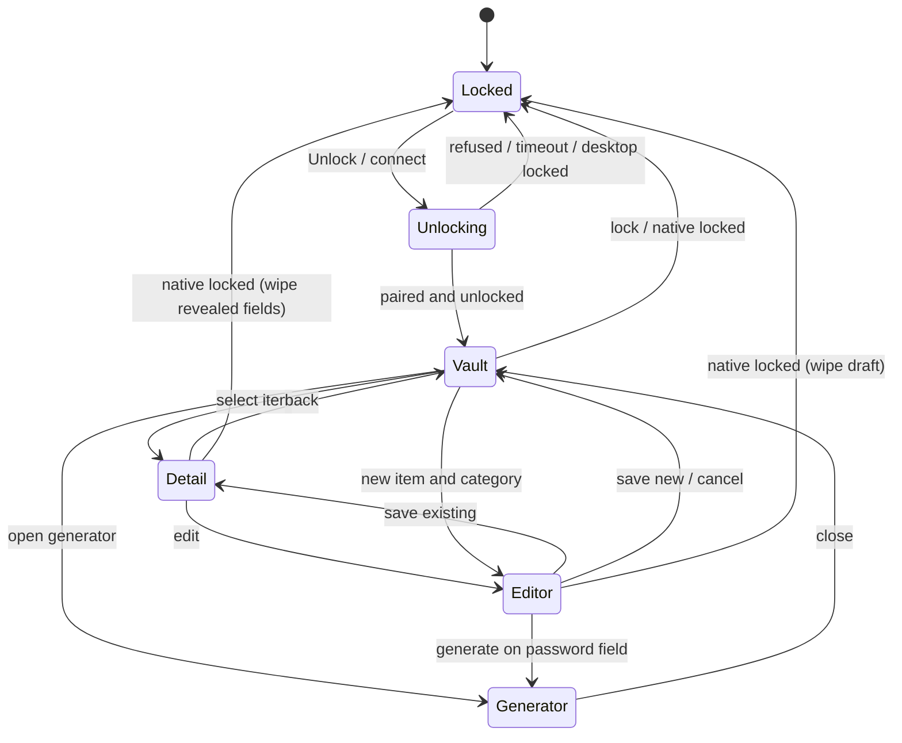

> 历史快照：仅表示 `8e61dc1` / PR #40 阶段，不是当前产品状态。当前清单见 [browser-parity-checklist.md](../browser-parity-checklist.md)。

# Browser 1:1 Parity Checklist — M3.0

> **Status:** living checklist. This document records what must be compared, what has been compared, and what evidence is still missing. It does not claim that M3 is complete.
>
> **Reference baseline:** 1Password 8.12.44.33 (desktop app + Chromium MV3 extension).
> **Locklark baseline:** `main` `8e61dc1`.
> **Reference implementation captured for comparison:** PR #40 `codex/browser-parity` head `f6e42c3`.
> **Delivery branches:** `feat/browser-save-generator` (M3.1), `feat/browser-popup-vault` (M3.2), `feat/browser-fill-v2` (M3.3), `feat/browser-watchtower` (M3.4).
> **Last updated:** 2026-11-06.

This checklist follows the parity method in [`docs/design.md`](../design.md) around line 97: fix the baseline, record the user-visible action and the reference result, record the substitute evidence, and mark each row with one of the five states. The English labels in parentheses are for cross-team use; the Chinese labels are authoritative.

The checklist is organized by the four M3 mining areas, then by the sub-milestone that owns the remaining work. A row is a **user-visible obligation family**, not a code file and not a single REA finding. A behavior can be fully implemented and still be `已实现未对照` until it has an exact-head browser comparison.

---

## 0. How to read and close this checklist

### 0.1 Baseline, scope, and non-claims

| Dimension | Value |
| --- | --- |
| Reference product | 1Password 8 desktop app and browser extension `8.12.44.33` |
| Reference browser package | Chromium MV3 CRX `aeblfdkhhhdcdjpifhhbdiojplfjncoa`; SHA-256 `4dee63a377abd8ab59a0f90f4c7a6ccef92ab2938c0e4d7eba857895195b7a43` |
| Reference artifacts | Kept in an external analysis workspace, never added to this repository |
| Locklark baseline for “already on main” statements | `main` `8e61dc1` |
| Locklark reference implementation | PR #40 `codex/browser-parity` head `f6e42c3` (open draft when evidence was captured) |
| Analysis host | Linux; REA static reconstruction plus public 1Password documentation |
| Browsers with retained E3/E4 evidence | Chromium 143 and 156; Firefox 157; Firefox fill/save/OTP path only |
| Browsers not yet run | Microsoft Edge binary; Safari (macOS only); Windows and macOS native UI flows |
| Out of scope for M3.0 | Mobile clients, store signing/release, external security audit, 1Password account protocol or file-format compatibility, Safari on Linux |
| Product claim | This is a behavioral parity program. It does not copy 1Password code, assets, branding, CSS, HTML structure, or locale catalogs. |

**Non-claims.** This document does not claim complete 1Password parity, successful store distribution, hardware-backed biometric verification, or an external security review. A build passing unit tests is not a browser comparison. A Chromium result is not an Edge, Firefox, or Safari result.

### 0.2 Status vocabulary (`docs/design.md:97`)

| Chinese state | English label | Meaning in this checklist | Minimum evidence to use it |
| --- | --- | --- | --- |
| `未实现` | `Tracked` | No implementation, or only a fixture/demo that does not satisfy the user-visible behavior | None; the gap and owner must be named |
| `已实现未对照` | `Partial` | Implementation exists, but an exact-head comparison is missing, or one or more material sub-behaviors are absent | E1/E2 at most; gap must be enumerated |
| `已实测` | `Verified` | Compared against the reference observable result on the exact head, with the success and refusal paths retained | E3 or E4, plus head SHA, browser/OS, command, and retained result |
| `平台不适用` | `Excluded` | The platform does not offer the capability, or the capability is out of scope by an explicit product decision | Platform/decision reference |
| `经用户确认的差异` | `Accepted difference` | A deliberate, user-approved difference from the reference | Decision reference (date, scope, and rationale) |

The English labels map to the Chinese states, not to a separate maturity scale. A row marked `Partial` is still open for M3 closure.

### 0.3 Evidence levels

| Level | Evidence | What it can prove | What it cannot prove |
| --- | --- | --- | --- |
| E0 | Public documentation and observed reference behavior | The behavior exists and what a user sees | That Locklark implements it |
| E1 | REA static reconstruction (`analyze-javascript-application`, focused views) | Entry points, message paths, permissions, state names, and obligation families | Runtime behavior on a real page |
| E2 | Unit/policy tests (`node --test`, `go test`) | Parsers, validators, state transitions, scoring, and refusal rules | Browser integration, native approval, or real DOM behavior |
| E3 | Controlled browser DOM/E2E (Playwright, synthetic HTTPS fixtures) | Focus, injection, events, navigation, iframe/shadow behavior, and negative cases | Native host, OS unlock, biometrics, or real vault persistence |
| E4 | Real native end-to-end (real browser + native host + MyGo UI) | Pairing, approval, vault transaction, lock, and cross-process behavior | Platforms and hardware that were not run |

A row is `已实测` only with E3 or E4 at the exact head. E1/E2 alone cap the row at `已实现未对照`. For rows that depend on the native host or vault, E3 without E4 is not enough to claim the full user task.

### 0.4 Closing rules

1. **One row, one user-visible obligation.** Sub-behaviors are listed in the row notes. If a sub-behavior is security-relevant, it needs its own negative test even when the row is otherwise closed.
2. **Status is about verification, not effort.** A large implementation with no comparison is `已实现未对照`; a missing behavior is `未实现` even if a partial code path exists.
3. **Exact head only.** Record the commit SHA, browser build, OS, command, and retained report/log. A result from an earlier head does not close a later head.
4. **Success and refusal.** Security-sensitive rows require both a positive path and a negative path (cross-origin iframe, bad RP ID, stale revision, locked vault, expired session, old document ID).
5. **No secrets in evidence.** Use synthetic fixtures. Do not commit screenshots, logs, vaults, or reference assets that contain real or synthetic secrets.
6. **Update in the same change.** A behavior change and its checklist status change land together. Do not mark a row verified in a later documentation-only PR without a fresh run.
7. **Accepted differences need a decision.** A difference is not “accepted” because implementation was difficult. Record who approved it, when, and what user-visible result changes.

### 0.5 Clean-room attestation and reference handling

The user decision of **2026-11-06T11:41Z** allows REA analysis of 1Password’s browser extension and desktop app **strictly to list behaviors**, with **zero code copied**.

**Allowed:** behavior names, user-visible states, public documentation, functional protocol facts (message names, permission names, algorithm identifiers), UI labels translated into Locklark’s own wording, and synthetic test fixtures.

**Forbidden:** copying source code, comments, identifiers, CSS, HTML structure, icons, images, fonts, locale catalogs, or branding; committing any file from the external reference workspace; committing the reference evidence bundle or the full REA ledger JSON (they embed reference paths and extracted content).

Checks run before commit:

```sh
git ls-files | grep -E '(^|/)(1p-ext|rea-m3|tmp/ref)' && exit 1 || true
git status --short
```

The full REA JSON ledgers remain outside the repository. This document retains only aggregate counts, evidence IDs, and behavior-level summaries.

---

## 1. Executive summary

### 1.1 Status at a glance

| Area | Rows | `已实测` | `已实现未对照` | `未实现` | `平台不适用` | `经用户确认的差异` |
| --- | ---: | ---: | ---: | ---: | ---: | ---: |
| Area 1 — inline menu, autofill, multi-step, split OTP, iframes | 15 | 7 | 2 | 6 | 0 | 0 |
| Area 2 — save/update prompt and inline generator | 9 | 0 | 0 | 9 | 0 | 0 |
| Area 3 — popup vault, shortcuts, context menu, options, Watchtower | 17 | 1 | 0 | 16 | 0 | 0 |
| Area 4 — identity/card, passkeys, shared desktop session, IPC | 24 | 7 | 7 | 8 | 1 | 1 |
| **Total** | **65** | **15** | **9** | **39** | **1** | **1** |

**Closed dispositions:** 17 of 65 rows have a terminal state (15 verified, 1 excluded, 1 accepted difference). **Open rows:** 48 (9 partial + 39 tracked). Of the 48 open rows, **37 are directly owned by M3.1–M3.4**; the remaining 11 depend on M2.3 (shared desktop session), M5 (cross-browser acceptance), hardware biometrics, or are tracked after M3.

**Where the verified rows live.** Only B10.1 (`_execute_action` shortcut) is verified on `main`. The other 14 verified rows are on PR #40 and must land with M1a before they can be claimed for `main`. PR #40 is an implementation reference, not a merged baseline.

**Highest-risk gaps.** Post-submit save/update and generator recovery (Area 2), popup vault search/detail/CRUD (Area 3), identity/card item model and fill (Area 4), Watchtower browser surfaces and privacy boundary (Area 3), and shared desktop↔extension session (Area 4). These are the rows most likely to produce a user-visible “1Password does this, Locklark does not” gap even after the smaller UI rows close.

### 1.2 Blockers and dependencies

| Blocker | Affected rows | Why it blocks closure | Owner / resolution |
| --- | --- | --- | --- |
| M2 item model v2 (`identity`, `credit_card`, sections, typed fields, multiple URLs, stable field IDs) not landed | B8.1–B8.4, B9.3–B9.4, B13.2 | The extension cannot browse, edit, or fill items the vault cannot represent | M2 C2/C3; then M3.2/M3.3 |
| M2 native-host protocol extensions (`generate`, staged-save, vault list/search/get/save, lock/session status, watchtower) not landed | B5.2–B5.5, B6.4, B9.*, B11.*, B15.* | The v1 host rejects unknown request types; extension-only fallbacks cannot provide full vault access | M2 protocol; capability negotiation in M3.1–M3.4 |
| PR #40 not merged; inline menu, passkeys, and auto-submit exist only there | B1.1–B1.2, B1.5, B2.1–B2.2, B3.1–B3.6, B7.1, B12a.1, B14.1 | A `main`-based checklist cannot claim these behaviors until M1a lands them | M1a; then rebase M3.1–M3.4 |
| No shared desktop session (M2.3); native host runs a separate MyGo process | B4.1–B4.4, B9.5, B11.1, B14.2, B17.2 | Lock/unlock propagation and biometric delegation require a local IPC session, not a second vault unlock | M2.3 + M3.2 |
| Full vault browsing requires host metadata ops; the extension never decrypts the vault | B9.1–B9.4, B11.3 | A local cache is not a substitute for item metadata, revisions, and CRUD | M2 protocol; M3.2 |
| Watchtower needs host-side health summary and an opt-in HIBP boundary | B15.1–B15.6 | The extension must not receive passwords or full hashes; local-only checks cannot score a vault it cannot read | M2 health API; M3.4 |
| Cross-origin iframe policy needs dual-origin verification and Permissions Policy handling | B12b.1–B12b.3 | A top-frame-only script cannot distinguish same-site from cross-site frames | M3.3 |
| Edge, Safari, Windows/macOS native UI, and hardware biometrics were not run | B14.2, B16.1–B16.3, B17.2 | A Chromium result is not a platform result | M1a/M5; per-platform acceptance |
| Clean-room review of every M3 implementation PR | All rows | A copied identifier, string catalog, or asset invalidates the parity claim | Reviewer checklist in §8.3 |

---

## 2. REA evidence and obligation ledger

### 2.1 Artifact register (external, not committed)

| Artifact | Scope | Digest / identifier | Recorded size or counts | Use in this checklist |
| --- | --- | --- | --- | --- |
| 1Password extension package | 1Password `8.12.44.33`, Chromium MV3 | SHA-256 `4dee63a377abd8ab59a0f90f4c7a6ccef92ab2938c0e4d7eba857895195b7a43`; CRX `aeblfdkhhhdcdjpifhhbdiojplfjncoa` | 7,378-byte `manifest.json`; 446 minified chunk files | Reference baseline; behavior and permission inventory only |
| 1Password entry-point analysis | `analyze-javascript-application` with `--source-path` and `--detail summary` | Evidence `ev_dc06ead41d89a3192ebd16e4ec9ea436a637e8227f791ee62a216b6dbdb6c206` | 14 KB summary; 111 MB evidence bundle; 163 obligations | Reference obligation ledger |
| 1Password obligation ledger | `build-reconstruction-obligation-ledger` | `rol_0ccccf4b59b09a405484405af123d941f98b7c4e557e387047692ec0c87b0c33` | 163 obligations: 8 protocol, 84 runtime, 71 application | Reference ledger counts and classes |
| 1Password focused inline-menu view | `inline/menu` entry points | Evidence `ev_c1532cd54b52a41f93408d1a79d7d0910b48e3f6ef76b3fbe5fd8b7295517466`; root SHA-256 `a715974bd9dabc75933815a02074e08b942892da536d53cfaa155b01aa32c1db` | 3 files; 319 findings | Inline menu, keyboard, positioning, generator states |
| 1Password focused notification view | `inline/notification` entry points | Evidence `ev_c216e8759940dc13169aaeed92ce27e7b1b4438b6bda4739cdfe4c31afeba688`; root SHA-256 `89e82104f33120a8207903864a639c9fc00650075dfcac1f9acd7a523ffae503` | 2 files; 428 findings | Post-submit save/update banner and actions |
| 1Password WebAuthn view | `webauthn` listeners, isolated bridge, modal | Evidence `ev_c8af7029f705f5b0ef471f32bb441fc743f31847e8f497a314eabe1d6445fa23`; view `ev_56c3494a3af56cd8fcdbac45432278abadc17eeff6cd18a13a3a2059735094b5` | 43,636 AST nodes; 238 findings; 1,546 call-flow relations; 136 promise-ownership relations; 56 boundary validations | Passkey create/get, conditional UI, UV, fallback |
| 1Password English string catalog | `messages.i18n-*` extraction | `1p-i18n-en-strings.json` (external) | 19 KB of message keys and English labels | Enumerating UI states; no strings copied into the product |
| Locklark PR #40 analysis | `browser-extension/dist/chromium` | Evidence `ev_16cb7c0804046a1e6287e20e4bc956c06492710fbd6810b53fe877726b3fbb25` | 12 MB analysis; 12 MB bundle | Current implementation obligations |
| Locklark obligation ledger | `build-reconstruction-obligation-ledger` | `rol_aed53d6482a0ec835059d5cc919c1070ed84c03fb2a8a3b9b2988ed1d352bd0b` | 111 obligations: 9 protocol, 98 runtime, 4 application | Current ledger counts and classes |
| Coverage evaluation | Boundary `locklark-browser-parity-m3` | `evaluate-reconstruction-coverage` output (external) | 5 surfaces, 1 claim, 6 open reasons | Coverage disposition and open-reason grouping |

The 15 MB and 1.6 MB ledger JSON files are deliberately **not** committed: they embed extracted reference paths and content, and committing them would violate the clean-room boundary. The IDs and aggregate counts above are sufficient to reproduce the analysis with the commands in §8.1.

### 2.2 Ledger reconciliation

REA’s atomic obligations are per-file and per-call-path. A single user-visible behavior (for example, “save a new login after submit”) can produce dozens of runtime obligations. This checklist consolidates them into **obligation families** so that one row has one owner and one closure gate.

| Layer | Atomic obligations | Protocol | Runtime | Application | How it is used here |
| --- | ---: | ---: | ---: | ---: | --- |
| 1Password reference ledger `rol_0cc…` | 163 | 8 | 84 | 71 | Enumerates reference behavior and protocol surface |
| Locklark ledger `rol_aed…` | 111 | 9 | 98 | 4 | Enumerates current implementation surface |
| Consolidated checklist families | 27 | 15 | 7 | 5 | Closure units in §2.4–§2.7 |

Counting rules: “protocol” means a cross-process or native-messaging boundary; “runtime” means DOM, worker state, UI behavior, or in-extension policy; “application” means manifest, build, permissions, commands, options, or registration. Mixed families are counted by their dominant boundary. The totals are **not** directly comparable: 163 atomic reference obligations collapse into 27 user-visible families, while 65 checklist rows cover both the reference behavior and the current substitute evidence.

### 2.3 Coverage evaluation and open reasons

`evaluate-reconstruction-coverage` evaluated boundary `locklark-browser-parity-m3` over five surfaces and one claim. It recorded **6 open reasons**; the raw output is external. The spec miners additionally identified sub-gaps inside otherwise-covered surfaces. The consolidated closure themes are:

| # | Consolidated open reason | Affected rows | Closure owner |
| ---: | --- | --- | --- |
| 1 | Post-submit save/update lifecycle cannot be reconstructed from the current extension | B5.1–B5.5 | M3.1 |
| 2 | Inline generator, confirm-field fill, and generated-password recovery are absent | B6.1–B6.4 | M3.1 |
| 3 | Popup vault browse/search/detail/CRUD, badge, and options are absent | B9.1–B9.5, B11.1–B11.3 | M3.2 |
| 4 | Identity/Credit Card item model and field fill are absent | B8.1–B8.4 | M3.3 + M2 |
| 5 | Watchtower browser surfaces and host health protocol are absent | B15.1–B15.6 | M3.4 |
| 6 | Shared desktop session, multi-step/frame policies, and cross-browser acceptance are incomplete | B4.1–B4.4, B7.2–B7.3, B12b.1–B12b.3, B13.1–B13.2, B14.2, B16.1–B16.2, B17.1–B17.2 | M2.3, M3.3, M5 |

**Five coverage surfaces:**

| Surface | Representative artifacts | Current coverage | Main open reason |
| --- | --- | --- | --- |
| Manifest, build, permissions | `browser-extension/build.js`, generated manifests | Partial | No `contextMenus`, `options_ui`, `lock`/`autofill` commands, or full-vault permissions |
| Background worker and native protocol | `background.js`, `internal/browserhost/protocol.go` | Strong v1 | No v2 item/vault/generate/watchtower/session ops |
| Content script and inline DOM | `content.js`, `core.js` | Partial | No save prompt, generator, multi-step session, split OTP, iframe, or shadow-DOM traversal |
| Popup UI | `popup.html`, `popup.js`, `popup.css` | Minimal | No vault browse/detail/editor, no Watchtower dashboard |
| Native host, vault, health | `internal/browserhost`, `internal/vault`, `internal/personal` | Login/SSH/Passkey v1 | No identity/card model, no shared session, no browser health API |

**Coverage ledger by area:**

| Area | Highest retained evidence | Coverage verdict | Why it is not closed | Next evidence |
| --- | --- | --- | --- | --- |
| Area 1 — inline menu, autofill, multi-step, split OTP, iframes | E4 on PR #40 for inline menu, fill, guarded auto-submit, single-field TOTP; E3 for DOM behavior | Partial | Multi-step session, split OTP, same-origin/same-site iframe fill, and open shadow DOM are absent; cross-site block is not yet a tiered policy | E2/E3 for B7, B12a.2, B12b.1–B12b.3; E4 on the merged head |
| Area 2 — save/update prompt and inline generator | E0/E1 only; the current extension has manual save only | Not covered | No submission observer, staged save, post-submit banner, never-save list, generator, confirm fill, or history | E2 trigger/classification tests, then E3 DOM and E4 native commit |
| Area 3 — popup vault, shortcuts, context menu, options, Watchtower | E1/E2 for the current candidate popup; no vault or Watchtower UI | Not covered | No search, browse, detail, editor, lock, badge, context menu, options page, health API, or HIBP client | E2 policy/UI tests, E3 fixture vault, E4 real vault |
| Area 4 — identity/card, passkeys, shared session, IPC | E4 on PR #40 for ES256 passkey create/get and truthful UV; E1/E2 for identity/card and shared session | Partial | Identity/card item model and fill are absent; shared desktop session, biometric delegation, Edge, and Firefox passkey E4 are not complete | E2 token/state tests, E3 DOM, E4 with M2.3 and per-browser runs |

### 2.4 Area 1 obligation ledger

The `A1-OBL-*` … `A4-OBL-*` identifiers are **checklist-local family IDs**, not raw REA `obl_*` IDs. They give each consolidated obligation family one owner and one closure gate; the raw per-file/per-call-path ledger remains external. A family can be partially closed when some of its parity rows are verified and others are not.

| Family | Obligation family | Class | Parity rows | Reference evidence | Disposition | Closure / owner |
| --- | --- | --- | --- | --- | --- | --- |
| `A1-OBL-01` | Inline menu host, positioning, keyboard, suppression | runtime | B1.1–B1.4 | Focused `inline/menu` REA `ev_c153…` (3 files, 319 findings); i18n menu states | B1.1/B1.2 closed on PR #40; B1.3/B1.4 open | M3.1; E3 scroll/resize and ignore-attribute fixtures |
| `A1-OBL-02` | Origin-bound candidate match, fill, guarded auto-submit | protocol + runtime | B1.5, B2.1–B2.2 | Locklark protocol ledger `rol_aed…`; `protocol.go`; PR #40 DOM evidence | Closed on PR #40 | M1a; retain E3/E4 and refusal paths |
| `A1-OBL-03` | Multi-step login session | runtime | B7.1–B7.3 | 1Password fill-session behavior; PR #40 statelessness | B7.1 closed; B7.2/B7.3 open | M3.3; 3-step E3 plus TTL/invalidation unit tests |
| `A1-OBL-04` | OTP target discovery and fill | runtime | B12a.1–B12a.2 | 1Password OTP behavior; focused inline-menu REA; PR #40 single-field limit | B12a.1 closed; B12a.2 open | M3.3; 6-box and 8-box E3 |
| `A1-OBL-05` | Frame and shadow-DOM trust boundary | protocol + runtime | B12b.1–B12b.3 | 1Password `all_frames` manifest; `docs/design.md:93` negative tests; coverage open reason | B12b.2 partial; B12b.1/B12b.3 open | M3.3; same-origin/same-site/cross-site and shadow fixtures |

### 2.5 Area 2 obligation ledger

| Family | Obligation family | Class | Parity rows | Reference evidence | Disposition | Closure / owner |
| --- | --- | --- | --- | --- | --- | --- |
| `A2-OBL-01` | Submission capture triggers (submit, Enter, click, SPA) | runtime | B5.1 | 1Password autosave capture/submission behavior | Open | M3.1; submit/Enter/click/SPA DOM tests |
| `A2-OBL-02` | Pending-save staging and navigation survival | protocol + runtime | B5.2–B5.3 | 1Password autosave sessions; focused notification REA `ev_c216…` (2 files, 428 findings) | Open | M3.1; navigation-survival unit and E3 |
| `A2-OBL-03` | New/update/unchanged classification, never-save, dismiss | runtime + protocol | B5.3, B5.5 | 1Password classification and never-save settings | Open | M3.1; truth table and host dismiss |
| `A2-OBL-04` | Multi-password capture for signup and change-password forms | runtime | B5.4 | 1Password save-request behavior; public signup/change-password docs | Open; PR #40 rejects multi-password forms | M3.1; 1/2/3-password DOM fixtures |
| `A2-OBL-05` | Generator modes, policy, and CSPRNG | runtime | B6.1–B6.2 | 1Password generator UI states; `internal/password` entropy floor | Open; desktop generator is length-only | M3.1; vectors, bounds, and entropy assertions |
| `A2-OBL-06` | Generator fill, history, and staged save | runtime + protocol | B6.3–B6.4 | 1Password generated-password history; `generate` host-op request | Open | M3.1; confirm-fill and history-zeroing tests |

### 2.6 Area 3 obligation ledger

| Family | Obligation family | Class | Parity rows | Reference evidence | Disposition | Closure / owner |
| --- | --- | --- | --- | --- | --- | --- |
| `A3-OBL-01` | Popup list, search, and suggestions | protocol + runtime | B9.1–B9.2 | 1Password popup REA subset; item-list/search behavior | Partial: current-origin candidates only | M3.2; E3 with a fixture vault |
| `A3-OBL-02` | Item detail, reveal/copy, Open & Fill | protocol + runtime | B9.3 | 1Password popup detail behavior; clipboard lease | Open | M3.2; E3 plus native clipboard test |
| `A3-OBL-03` | Item create, edit, and state changes | protocol | B9.4 | 1Password create/edit categories; M2 item model v2 | Open | M3.2 + M2; Go host and E3 |
| `A3-OBL-04` | Lock, badge, and per-site controls | protocol + runtime | B9.5, B11.1–B11.2 | 1Password lock/badge/exclusion behavior | Partial: disconnect only; no badge | M3.2; E4 lock propagation |
| `A3-OBL-05` | Commands and context menu | application | B10.1–B10.3 | 1Password manifest commands and context menus | Partial: `_execute_action` only | M3.2; manifest assertions and E3 |
| `A3-OBL-06` | Options page and settings schema | application | B11.3 | 1Password options sections; storage keys | Partial: popup checkboxes only | M3.2; options tests |
| `A3-OBL-07` | Watchtower local checks and UI | runtime + protocol | B15.1–B15.3, B15.5–B15.6 | 1Password Watchtower report; `health.go` v1 | Partial: CLI/desktop only | M3.4; Go unit and popup E3 |
| `A3-OBL-08` | HIBP k-anonymity opt-in | protocol + application | B15.4 | 1Password HIBP range protocol; `docs/design.md:95` | Open | M3.4; TLS fixture, audit, and opt-in UI |

### 2.7 Area 4 obligation ledger

| Family | Obligation family | Class | Parity rows | Reference evidence | Disposition | Closure / owner |
| --- | --- | --- | --- | --- | --- | --- |
| `A4-OBL-01` | Identity item model and field fill | protocol + runtime | B8.1–B8.2 | 1Password 34 identity tokens; M2 item model v2 | Open | M3.3 + M2; token table and DOM fixtures |
| `A4-OBL-02` | Credit Card item model and field fill | protocol + runtime | B8.3–B8.4 | 1Password 10 card tokens; `<select>` expiry behavior | Open | M3.3 + M2; select matrix |
| `A4-OBL-03` | WebAuthn create/get and passkey persistence | runtime + protocol | B3.1–B3.6 | WebAuthn REA `ev_c8af…` (43,636 AST nodes; 238 findings; 1,546 call-flow relations) | Closed on PR #40 | M1a; E4 with an independent RP verifier |
| `A4-OBL-04` | Conditional UI, passkey management, advanced extensions | runtime + application | B13.1–B13.3 | 1Password conditional mediation; public docs | Partial; B13.3 accepted difference | Post-M3; management UI in M3.2 |
| `A4-OBL-05` | User verification and biometric delegation | protocol | B14.1–B14.2 | 1Password biometric native messaging; `internal/osunlock` | B14.1 closed; B14.2 open | M2.3 + hardware E4 |
| `A4-OBL-06` | Shared desktop session and lock propagation | protocol | B4.1–B4.4 | 1Password shared-lock/session and native-messaging behavior | Partial: host→extension lock only; separate session | M2.3 + M3.2; E4 |
| `A4-OBL-07` | Cross-browser manifest and acceptance | application | B16.1–B16.3 | 1Password manifest (`gecko`, Safari target); Locklark `build.js` | Partial: Chromium/Firefox; Edge/Safari gaps | M1a/M5; per-browser E4 |
| `A4-OBL-08` | Commands, pairing UX, onboarding | application | B17.1–B17.2 | 1Password commands and connection states | Partial: `_execute_action` only; minimal popup | M3.2/M5; manifest and E3 |

### 2.8 Ledger roll-up

| Area | Obligation families | Checklist rows | `已实测` | `已实现未对照` | `未实现` | `平台不适用` | `经用户确认的差异` |
| --- | ---: | ---: | ---: | ---: | ---: | ---: | ---: |
| Area 1 | 5 | 15 | 7 | 2 | 6 | 0 | 0 |
| Area 2 | 6 | 9 | 0 | 0 | 9 | 0 | 0 |
| Area 3 | 8 | 17 | 1 | 0 | 16 | 0 | 0 |
| Area 4 | 8 | 24 | 7 | 7 | 8 | 1 | 1 |
| **Total** | **27** | **65** | **15** | **9** | **39** | **1** | **1** |

---

## 3. Area 1 — Inline menu, autofill, multi-step, split OTP, iframes

### 3.1 Reference behavior (1Password 8.12.44.33)

**3.1.1 Inline menu trigger and field roles.**

| Role | Reference detection | User-visible result |
| --- | --- | --- |
| Username / email | `type="email"`, `autocomplete` containing `username`/`email`, or `name`/`id`/`placeholder`/`aria-label` matching user/login/email/account/identifier | Inline menu anchored to the focused field lists matching logins |
| Current password | `type="password"` with `current-password`, or the single password field in a login form | Candidate logins and a generate action; fill does not submit unless auto-submit is enabled |
| New / change password | `new-password`, or 2–3 password fields in a signup/change-password form | Generator is the primary action; save/update and confirm-field fill are offered |
| One-time code | `autocomplete="one-time-code"` or OTP/TOTP/2FA/MFA/verification-code heuristics | Inline OTP candidate and fill action; split boxes are supported in the reference |
| Passkey | WebAuthn `create`/`get`, including conditional mediation | Passkey modal or conditional suggestion; see Area 4 |

Fields marked with the reference product’s ignore attribute, and fields that are hidden, disabled, read-only, inert, or zero-sized, do not trigger the menu. A per-site “never show here” setting suppresses the menu on that origin. These are functional behaviors; Locklark uses its own attribute name (`data-locklark-ignore`) and its own wording.

**3.1.2 UI isolation and positioning.** The reference renders the menu in a closed shadow root, anchored below the focused input (above when near the viewport bottom), with page CSS unable to bleed in and page scripts unable to inspect or spoof candidate rows. It repositions on scroll and resize, and dismisses when the anchor disconnects, hides, or leaves the viewport.

**3.1.3 Keyboard.** `ArrowDown` from the input enters the menu; `ArrowUp`/`ArrowDown` cycle items; `Enter` activates; `Escape` dismisses and returns focus to the input.

**3.1.4 States and URL matching.** Locked/unpaired shows an unlock/connect action and re-queries after unlock. Unlocked shows active logins for the current site; archived items are excluded. URL matching supports origin, registrable domain, exact host, exact URL, and never; untrusted schemes are rejected. Filling uses the native value setter and dispatches bubbling `input` and `change` events so framework-controlled inputs update.

**3.1.5 Guarded auto-submit.** Auto-submit is a global preference with a per-login override. It runs only after an explicit fill, and only when:

- the document is top-level (or a verified same-origin/same-site frame) and HTTPS;
- the form has a visible username/email and a visible `current-password` field (never `new-password`);
- the form method is `POST`;
- the form `action` and submit button `formaction` resolve to the same-origin HTTPS URL, rechecked **after** the fill events because page script can mutate them;
- there is exactly one visible eligible submit button, and its label does not match destructive or non-login patterns;
- submission uses `HTMLFormElement.prototype.requestSubmit`, not a synthetic click on an arbitrary element.

**3.1.6 Continuous multi-step login.** The reference starts a tab-bound fill session when the user selects a login on a username-only screen. The selected item is retained across a dynamic password reveal in the same document or a same-site navigation to the password/OTP step. The session is cleared when the flow completes, the tab closes, the site changes, the vault locks, or a short TTL expires. If the password field appears dynamically, the page watcher resolves the pending fill and either fills it or re-surfaces the remembered item at the top of the inline menu.

**3.1.7 Split OTP.** The reference detects a single OTP input and a group of six or eight single-character OTP boxes. Filling a split group writes one digit per box, advances focus, and dispatches the event sequence expected by controlled inputs. A group whose length does not match the code is not filled.

**3.1.8 Frames and shadow DOM.** The reference injects into all frames and applies a three-tier policy: same-origin frames are treated like the top document; same-site (eTLD+1) HTTPS frames are allowed when both origins validate; cross-site frames are blocked for login/OTP/passkey fill, with an explicit origin warning if a user gesture is ever allowed for a payment iframe. Open shadow roots are traversed with `composedPath()` and a bounded deep query; closed shadow roots are not traversed.

### 3.2 Parity table

Status column is as of PR #40 `f6e42c3` where the behavior exists there; `main` `8e61dc1` is shown separately. A verified row that exists only on PR #40 is not a `main` claim.

| ID | Capability / user action | 1Password 8.12.44.33 observable result | Locklark `main` `8e61dc1` | Locklark PR #40 `f6e42c3` | Status | Gap and target |
| --- | --- | --- | --- | --- | --- | --- |
| **B1.1** | Closed-shadow inline menu on focus | Closed-shadow panel anchored to the focused username/password/OTP/passkey input; page cannot inspect candidate titles or actions | Popup only; no page inline UI | `content.js` renders a closed-shadow panel on `focusin` | `已实测` (Verified) | Keep through M1a; add reposition/ignore attributes in M3.1 |
| **B1.2** | Keyboard navigation | `ArrowDown` enters, `ArrowUp`/`ArrowDown` cycle, `Enter` activates, `Escape` dismisses and refocuses | None | `content.js` handles `ArrowDown`, `ArrowUp`, `Escape`, and button `Enter` | `已实测` (Verified) | Keep through M1a |
| **B1.3** | Reposition on scroll/resize; hide when anchor hides | Menu follows the anchor and dismisses if the input is hidden, removed, or scrolled out of view | None | Panel position is computed once; no scroll/resize observer | `已实现未对照` (Partial) | M3.1; add passive scroll/resize listeners and disconnect/zero-rect dismissal |
| **B1.4** | Ignore attribute and per-site suppression | Inputs/forms marked ignore, and origins on the never-show list, do not open the menu | None | Checks disabled/readOnly/hidden only; no ignore attribute or origin list | `未实现` (Tracked) | M3.1 + M3.2 options; add `data-locklark-ignore` and disabled-inline origin list |
| **B1.5** | Origin/domain/port candidate filtering and sender verification | Candidates match the tab URL by the configured mode; sender frame/document/origin is re-verified before fill | `core.originFromURL` and `match` | `contentSender`, `contentContext`, and `inline-match` verify sender and document | `已实测` (Verified) | Keep through M1a; add same-site frame policy in M3.3 |
| **B2.1** | Global and per-login auto-submit toggle | Global “sign in automatically” plus per-item override | None | `background.js` and `popup.js` persist `autoLogin` and `loginOverrides` | `已实测` (Verified) | Keep through M1a |
| **B2.2** | Guarded POST `requestSubmit` | Submits only eligible POST forms, rechecks action/formaction after fill events, uses `requestSubmit` | None | `core.fillDocument` rechecks after `input`/`change` and calls `requestSubmit` | `已实测` (Verified) | Keep through M1a; extend to step-specific forms in M3.3 |
| **B7.1** | Username-only or password-only screen fill | Fills a visible identifier-only or password-only screen when the user selects an account | Requires both a username and a password input | Supports username-only (`user && !pass`) and password-only (`pass && !user`) | `已实测` (Verified) | Keep through M1a |
| **B7.2** | Continuous multi-step fill session | Remembers the selected login across dynamic reveal and same-site navigation; prioritizes it on password/OTP steps | Stateless per fill; context/rows cleared after fill and on navigation | Stateless: `background.js` clears context/rows after Step 1 and on `tabs.onUpdated` | `未实现` (Tracked) | M3.3; add tab-bound `multiStepSessions` with TTL and invalidation |
| **B7.3** | Multi-step auto-advance | Can submit Step 1 identifier-only and Step 2 password-only forms when auto-submit is enabled and the form is eligible | None | Auto-submits only when both username and password are present | `未实现` (Tracked) | M3.3; extend guarded `autoLogin` to step-specific forms |
| **B12a.1** | Single-field TOTP fill | Detects one `one-time-code` input and fills a 6- or 8-digit code | Popup TOTP fill | Inline and popup TOTP fill; requires one input and `maxLength >= 6` | `已实测` (Verified) | Keep through M1a; expand heuristics only when unambiguous |
| **B12a.2** | Split OTP digit inputs | Detects 6 or 8 single-character boxes, fills one digit per box, advances focus, dispatches framework-compatible events | Rejects `maxLength < 6`; requires exactly one input | Rejects `maxLength < 6`; requires exactly one input | `未实现` (Tracked) | M3.3; add `findOTPTargets()` single/split modes and atomic fill |
| **B12b.1** | Same-origin and same-site iframe fill | Injects into frames; allows same-origin and same-site HTTPS login/checkout iframes after dual-origin validation | Top frame only (`frameIds: [0]`, `window === window.top`) | Top frame only (`all_frames: false`, `window !== window.top`, `sender.frameId === 0`) | `未实现` (Tracked) | M3.3; `all_frames: true` plus top/frame origin verification |
| **B12b.2** | Cross-origin iframe blocking and warning | Blocks silent credential fill into cross-site frames; prevents a frame from receiving top-site credentials; warns on explicit gesture | Blocks all frames (top-only) | Blocks all frames (top-only) | `已实现未对照` (Partial) | M3.3; preserve hard block while allowing same-origin/same-site; add origin warning |
| **B12b.3** | Open shadow-DOM traversal | Uses `composedPath()` and bounded deep traversal to find and fill inputs inside open shadow roots | `document.querySelectorAll("input")` only | `event.target` and `document.querySelectorAll("input")` do not pierce open shadow roots | `未实现` (Tracked) | M3.3; add `eventInputTarget()` and bounded `queryAllDeep()` |

### 3.3 Implementation contract for M3.3 (and the inline-menu parts of M3.1)

**3.3.1 Multi-step session.** Keep a per-tab ephemeral record in `background.js`; never persist it to disk.

| Field | Meaning |
| --- | --- |
| `tabId`, `windowId` | Exact tab/window binding |
| `siteKey` | Registrable domain (eTLD+1) or origin used to decide whether a navigation is still the same login flow |
| `origin` | Initial HTTPS origin |
| `itemId`, `revision`, `title` | Selected login, bound to the exact revision |
| `stepCompleted` | `username` or `password` |
| `expiresAt` | `Date.now() + 120_000` (renewed on a successful step) |

Creation and invalidation:

- On a successful username-only fill, store the record with `stepCompleted: "username"`.
- On a combined or password-only fill, update to `stepCompleted: "password"` and renew the TTL so a following OTP step can reuse the item.
- On a successful OTP fill, delete the record.
- Delete on `disconnect`, vault `locked`, `unpaired`, tab close, TTL expiry, non-HTTPS navigation, or a navigation whose `siteKey` differs.
- Do **not** delete on same-site navigation: the flow deliberately moves from `/login/identifier` to `/login/challenge/pwd` to `/login/2fa`.

`core.fillDocument` should return a structured step outcome (`username-only`, `password-only`, `combined`) while remaining truthy for existing callers. `content.js` attaches a debounced `MutationObserver` when a step fill occurs; when a new password/OTP field becomes visible, it either lets `focusin` open the menu or queries `inline-match` and highlights the remembered item with a “continue sign-in” label.

**3.3.2 Split OTP target discovery.** Expose `core.findOTPTargets(root)`:

1. Collect eligible inputs (`text`, `tel`, `number`, `password`) that are visible, connected, enabled, writable, and not ignore-marked.
2. **Single mode:** exactly one input with `autocomplete="one-time-code"` (or an unambiguous OTP heuristic when no password field is being filled) and `maxLength === -1 || maxLength >= 6`.
3. **Split mode:** a group of 6 or 8 adjacent single-character inputs in the same form or nearest common container. Valid when at least one input has `one-time-code`, or the group/container label/legend/name/id matches OTP/TOTP/2FA/MFA/code/digit/pin/verify/token/passcode, or all inputs are numeric/tel and are the only visible text/numeric inputs in that step.
4. Refuse ambiguous groups (more than one valid group), groups with fewer than 6 or more than 8 boxes, and groups whose length does not match the code to fill.

**3.3.3 Split OTP fill.** For each digit `d_i` in box `el_i`, in order:

1. Verify the document is still the expected origin, the box is eligible, and the 1500 ms injection budget has not expired.
2. Focus `el_i`.
3. Dispatch `keydown` (`key: d_i`, `code: "Digit" + d_i`, bubbling, cancelable, composed).
4. Dispatch `beforeinput` (`data: d_i`, `inputType: "insertText"`, bubbling, cancelable, composed).
5. Set the value with the native `HTMLInputElement.prototype.value` setter unless the page’s handler already set it.
6. Dispatch `input` and `change`.
7. Dispatch `keyup`.
8. After the last digit, leave focus on the last box (or blur only if the fixture proves the site requires it) and zero the in-memory code string.

**3.3.4 Frame policy.** Replace the top-frame guard with an HTTPS/secure-context guard and enforce this table in `background.js`:

| Tier | Condition | Login/OTP/Passkey | Identity/Card | Required checks |
| --- | --- | --- | --- | --- |
| 1 | `frameId > 0`, `frameOrigin === topOrigin` | Allowed | Allowed | Probe top frame (`frameId: 0`) and target frame; verify `documentId`; same-origin HTTPS form action |
| 2 | `frameId > 0`, same eTLD+1 (e.g. `login.example.com` in `www.example.com`) | Allowed when the item matches the site and both frames are HTTPS | Allowed | Dual-origin probe; item site match; target-frame `documentId`; no cross-site action |
| 3 | `frameId > 0`, different eTLD+1 | **Refused** | Only explicit user gesture inside the frame, with both origins disclosed; never auto-fill | Refuse login/save/update/OTP/passkey; show origin warning; native approval when not in quick mode |

`content.js` must not silently treat a cross-site frame as the top page. The content script may show a warning, but the worker is the enforcement point: `inline-match`, `inline-fill`, `inline-save`, `inline-update`, `inline-otp`, and passkey requests from a cross-site frame return a refusal, not an empty candidate list that could be mistaken for “no logins”.

**3.3.5 Shadow DOM.** In `content.js`, resolve the actual control from `event.composedPath()` before checking `loginInput`. In `core.js`, use a bounded recursive query over open shadow roots (maximum depth 8), and make eligibility walk across shadow boundaries via `getRootNode().host`. `logicalForm(el)` returns `el.form || el.closest("form") || (el.getRootNode() instanceof ShadowRoot ? el.getRootNode() : null)`. Do not traverse closed shadow roots.

**3.3.6 Security invariants.** The content script never receives passwords, identity values, card numbers, or TOTP seeds. The worker injects values directly into the target frame’s isolated world with `scripting.executeScript` targeting the exact `documentId`, within the existing 1500 ms budget, and zeros temporary buffers in `finally`. Every fill revalidates origin, tab, document, item revision, and item state. A navigation after approval must not redirect an old reply into the new document.

### 3.4 Acceptance matrix

| Layer | Success path | Refusal/failure path | Evidence to retain |
| --- | --- | --- | --- |
| E2 unit/policy | Menu positioning math; ignore attribute; multi-step TTL/renewal/invalidation; split OTP 6/8 detection; shadow traversal depth; frame-tier classifier | 5-box group; 7-box group; code length mismatch; cross-site frame; closed shadow root; stale document ID; non-HTTPS; hidden anchor | `node --test` output; exact head |
| E3 DOM | Focus opens menu; keyboard cycle/activate/Escape; scroll/resize reposition; 3-step username → password → OTP; split 6/8 fill; same-origin iframe; same-site iframe; open shadow component | Cross-site login iframe blocked with warning; cross-origin form action; hidden/disabled/read-only fields; ambiguous forms; group length mismatch | Playwright report; fixture URLs; screenshots without secrets |
| E4 native | Real Chromium + native host: fill from same-origin iframe after native approval; multi-step flow with lock at each step | Lock during step; navigation to a different site; old document after navigation; cross-site frame refused before approval | Native log; approved item/revision; browser/OS; redacted screenshots |

### 3.5 Residual risks

- Multi-step flows are site-specific; a generic state machine can misfire on username recovery, newsletter, search, or checkout forms. The classifier must prefer “no password field on the step” and a visible identifier, not just URL changes.
- Split OTP groups are frequently implemented with controlled inputs that reject direct value writes. The event sequence must be verified per framework, not assumed.
- Same-site is not the same as same-origin. A compromised sibling subdomain is still same-site; the policy must not let it receive credentials for a different subdomain. The item’s allowed site and the frame’s own origin both matter.
- `all_frames: true` increases injection surface and performance cost. The content script must be cheap on non-login pages and must not expose candidate metadata to cross-site frames.
- Shadow DOM traversal can cross component boundaries that the page did not intend to expose. Limit traversal to open roots, bound depth, and never fill a control that is not visible and writable.

---

## 4. Area 2 — Save/update prompt and inline password generator

### 4.1 Reference behavior (1Password 8.12.44.33)

**4.1.1 Submission capture triggers.** The reference captures candidate credentials before the page unloads or clears the fields. It observes four independent triggers:

| Trigger | Observable condition | Why it matters |
| --- | --- | --- |
| Form submit | Capture-phase `submit` event on the document | Standard server-rendered login/signup forms |
| Enter key | Trusted `Enter`/`NumpadEnter` keydown inside a credential input | Forms that submit without a click, and SPAs that intercept Enter |
| Submit-like click | Trusted click/pointerdown on a submit button or a button whose text/id/aria-label matches sign-in/continue/register/save/update semantics | Sites with custom buttons outside the form |
| SPA transition | URL change via History API, `popstate`/`hashchange`, or the password field being removed/hidden shortly after interaction, without a form submit | React/Vue/Angular flows that call `fetch()` and re-render |

The reference keeps a short-lived snapshot of the last edited credential so a field removed by an SPA transition can still be staged. The snapshot is bounded in time and never persisted.

**4.1.2 Staging across navigation.** Because a submit usually navigates to a dashboard, welcome page, or 2FA step, the old document cannot wait for synchronous approval. The content script stages the credential immediately; the worker keeps it in memory with a bounded TTL (about five minutes), keyed by tab and origin, and forwards it to the native host when the host supports staged saves. On the next document (or after the SPA transition settles), the content script asks for a pending save and renders a closed-shadow banner at the top-right, and the popup shows the same pending save at the top.

**4.1.3 Classification.** The reference distinguishes four outcomes:

| Outcome | Condition | User-visible result |
| --- | --- | --- |
| Unchanged | The submitted username/password exactly match the credential just autofilled, and this is not a password-change form | No prompt; the credential is already saved |
| New | No saved login for the origin matches the username, or the origin has no saved logins | “Save in Locklark”, with editable title, username, and concealed password preview |
| Update | A saved login matches the username but the password differs, or a change-password form has an existing login for the origin | “Update existing login”; the **new** password is saved, never the old `current-password`; “Save as new login” remains available |
| Never | The origin is on the never-save list, or the global save-offer setting is disabled | No prompt; manual save remains possible |

For a password-change form, the reference captures `new-password` (and the confirm field only for validation), not `current-password`. If a form has multiple candidate logins, the user can choose which item to update.

**4.1.4 Banner and popup actions.** Save/update commits the staged credential and updates the item; update adds a password-change history entry. Dismiss discards the staged save. “Never save for this site” adds the normalized HTTPS origin to the local never-save list, syncs it to the host when supported, dismisses the banner, and suppresses future post-submit prompts on that origin.

**4.1.5 Inline generator.** The reference offers a generator on signup/change-password fields (`new-password`, or 2–3 password fields in a signup/change-password form) and from any password field’s inline overflow. It supports three modes:

| Mode | Reference controls | Defaults / bounds | Fill behavior |
| --- | --- | --- | --- |
| Random characters | Length, digits toggle, symbols toggle | 16–64 characters, default 24; digits and symbols on | Fill the new-password field; show entropy/strength |
| Memorable words | Word count, separator, capitalization, digits toggle | 3–10 words, default 4–5; hyphen separator, capitalization on | Fill the new-password field; show preview |
| PIN | Digit count | 4–12 digits, default 6 | Fill the new-password field |

The reference displays a live preview, an entropy/strength indicator, a regenerate action, and a primary fill action.

**4.1.6 Multi-field fill, history, and recovery.** Filling a generated password writes it to the new-password field and to any paired confirm-password field, leaves `current-password` untouched, and dispatches bubbling `input`/`change` events. It records the generated password in a bounded history (about 20 entries) so a password is not lost if the site submits via XHR without a standard submit event, and it stages a pending save immediately. History is cleared on lock/disconnect or explicit clear.

### 4.2 Parity table

| ID | Capability / user action | 1Password 8.12.44.33 observable result | Locklark `main` `8e61dc1` | Locklark PR #40 `f6e42c3` | Status | Gap and target |
| --- | --- | --- | --- | --- | --- | --- |
| **B5.1** | Detect form submission | Captures credentials on submit, Enter, submit-button click, or SPA field removal | Manual popup save only | Manual inline/popup save; no submission observer | `未实现` (Tracked) | M3.1; add capture-phase submit, Enter, click, and SPA snapshot |
| **B5.2** | Stage pending save across navigation and show a post-submit banner | Stages in memory with a TTL; shows a top-right banner and a popup banner on the next page | None; navigation clears state | None; navigation cancels the pending save | `未实现` (Tracked) | M3.1; add `stagedSaves` keyed by tab/origin and a closed-shadow banner |
| **B5.3** | Classify new vs update vs unchanged | Suppresses when the submitted credential matches the autofilled one; offers update for an existing username or change-password form; offers save-new otherwise | Manual “save new” vs “update” buttons | Manual “save new” vs “update” buttons | `未实现` (Tracked) | M3.1; add last-filled credential memory and classification truth table |
| **B5.4** | Capture multi-password signup/change forms | Captures the new password on signup (`new` + confirm) and change-password (`current` + `new` + confirm) forms | Rejects `passwords.length !== 1` | Rejects more than one password or `new-password` | `未实现` (Tracked) | M3.1; add 1/2/3-password role classification |
| **B5.5** | Never save for this site | Per-origin never-save list, synced to the host, suppresses future prompts | None | None | `未实现` (Tracked) | M3.1; add `neverSaveOrigins` and host `dismiss-save` sync |
| **B6.1** | Inline generator trigger on signup/change-password fields | Prioritizes generator on new-password and multi-password forms; also available from any password field | Native desktop length-only generator | No extension generator | `未实现` (Tracked) | M3.1; add field detection and inline generator panel |
| **B6.2** | Generator modes and controls | Random (length/digits/symbols), Memorable (words/separator/capitalize), PIN (digits) | Native desktop length-only generator | None | `未实现` (Tracked) | M3.1; add CSPRNG modes, bounds, live preview, entropy |
| **B6.3** | Fill new-password and confirm-password together | Writes both fields, skips current-password, fires `input`/`change` | None | None | `未实现` (Tracked) | M3.1; add `fillGeneratedPassword` and confirm validation |
| **B6.4** | Generated-password history and staged recovery | Bounded history plus immediate staged save, so an XHR-submitted signup is not lost | None | None | `未实现` (Tracked) | M3.1; add history with lock zeroing and auto-stage |

### 4.3 Lifecycle and state contract for M3.1

**4.3.1 Staged save record.** Keep this in worker memory only; never write it to `storage.local` or `storage.session`.

| Field | Purpose |
| --- | --- |
| `stageId` | Random one-use identifier |
| `tabId`, `windowId` | Exact tab/window binding |
| `origin` | Normalized HTTPS origin captured at stage time |
| `documentId` | Document that produced the capture; used for revalidation, not as a permanent binding after navigation |
| `username` | Captured username or empty string for a password-only change form |
| `password` | Captured new password; zeroed immediately on commit, dismiss, expiry, lock, or disconnect |
| `title` | Editable title, defaulting to the hostname or matched item title |
| `isNewPassword`, `isPasswordChange` | Role flags from the 1/2/3-password classifier |
| `mode` | `new`, `update`, `unchanged`, or `never` |
| `existingItemId`, `existingRevision` | Set only for `update` |
| `createdAt`, `expiresAt`, `timer` | Five-minute TTL and cleanup timer |

`lastFilledCredentials` is a separate short-TTL map (`tabId` → origin, item id, revision, username, password, filledAt) used only to detect `unchanged`. It is cleared on lock/disconnect and after the comparison window.

**4.3.2 Sequence.**

```mermaid
sequenceDiagram
    participant Page
    participant Content as content.js
    participant Worker as background.js
    participant Host as native host
    participant Vault as vault
    Page->>Content: submit / Enter / click / SPA transition
    Content->>Content: capture username and new password before unload
    Content->>Worker: inline-stage-save
    Worker->>Worker: classify new/update/unchanged/never; stage 5 min
    Worker->>Host: stage-save (v2) or keep in worker (v1)
    Page->>Content: next document or settled SPA view
    Content->>Worker: inline-pending-save
    Worker-->>Content: pending save with mode and title
    Content-->>Page: closed-shadow save/update banner
    Page->>Content: Save / Update / Dismiss / Never
    Content->>Worker: commit or dismiss
    Worker->>Host: commit-staged-save, or save-new/save-update then commit-ready
    Host->>Vault: single transaction
```

**4.3.3 Classification truth table.**

| Condition (evaluated in order) | Result |
| --- | --- |
| `offerSaveLogins === false` or origin in `neverSaveOrigins` | `never`; no banner; do not keep the password |
| Last autofilled credential matches username and password, and this is not a password change | `unchanged`; no banner |
| Origin has an active login with the same username and a different password, or this is a password change with exactly one matching login | `update`; prefill item id/revision/title |
| A password change has multiple matching logins | `update` but require the user to choose the item before commit |
| Otherwise | `new`; title defaults to hostname |
| Worker is not connected/unlocked | Stage as `new` or `update`; the banner offers “unlock and save” and resolves the exact item after connect |

**4.3.4 Commit paths.** The extension must work against both the v1 host on `main`/PR #40 and the M2 v2 host.

- **v2 path:** send `commit-staged-save` with capability, stage id, origin, tab/window/document identity, title, and optional item id/revision; expect `saved`. Verify the current tab is still at the staged origin before sending.
- **v1 path:** bind the commit to the **current** verified post-submit document (`c_after` on the same origin), not the old form document. Send `save-new` or `save-update` with the staged username/password, then handle `save-ready` and `commit-ready` exactly as the existing v1 handshake requires. Revalidate origin/tab/document after `save-ready`; zero the staged password after it is consumed.
- If an `update` item disappeared or its revision changed, refresh `match`; if no matching login remains, fall back to `save-new` only with an explicit user-visible change of action.
- On any failure, keep the result **unknown** rather than silently retrying. The user must inspect the vault before repeating a save.

**4.3.5 Generator contract.** The generator is pure and local unless the host advertises a generator capability.

| Profile | Bounds | Defaults | Required properties |
| --- | --- | --- | --- |
| `random` | 8–256 characters | 24; digits on; symbols on | At least one uppercase, lowercase, digit, and symbol when enabled; unbiased rejection sampling; Fisher-Yates shuffle with CSPRNG draws |
| `memorable` | 3–10 words | 4; hyphen separator; capitalize on; digits off | Curated ASCII word list; separator choices `hyphens`, `spaces`, `periods`, `commas`, `underscores`, `numbers`, `numbers-and-symbols`; no offensive or ambiguous words |
| `pin` | 4–12 digits | 6 | Digits only; CSPRNG; no leading-zero special case unless the site requires it |

The reference UI bounds are 16–64 random characters, 3–10 words, and 4–12 PIN digits (§4.1.5). Locklark may widen random generation to 8–256 only with an explicit entropy floor and UI bounds that still pass site policies.

Return `{ password, profile: { mode, length, alphabet_size, entropy_bits_floor } }`. The profile is metadata, not a secret. The UI shows the mode, length/word count, digit/symbol/capitalize controls, a live preview, an entropy badge, regenerate, and fill.

**4.3.6 Confirm-field fill.** `fillGeneratedPassword(expectedOrigin, password, expiresAt)` verifies the top-level document (or verified same-origin frame), origin, and deadline; classifies `currentPass`, `newPass`, and `confirmPass` with the 1/2/3-password rules; verifies the form action is same-origin HTTPS; writes only `newPass` and `confirmPass`; dispatches `input` and `change`; and returns the filled count and username. It never overwrites `currentPass`.

**4.3.7 History and recovery.** `generatedHistory` is worker memory only, never persisted; it is bounded to 20 entries, records `{ id, origin, username, password, profile, createdAt }`, and is cleared on lock/disconnect or explicit clear. Filling a generated password records history and immediately stages a pending save with `isNewPassword: true`, so an SPA that submits via `fetch()` still offers save/update.

### 4.4 Protocol and fallback

| Capability | v2 request/response | v1 behavior on PR #40 | Extension fallback |
| --- | --- | --- | --- |
| `generate` | `{ type: "generate", options, save_history? }` → `{ type: "generated", generated_password, profile, history_id }` | Unknown type; connection may be refused | `core.generatePassword()` with `crypto.getRandomValues` |
| Staged save | `stage-save`, `pending-save`, `commit-staged-save`, `dismiss-save` | Only `save-new`/`save-update` → `save-ready` → `commit-ready` | Worker `stagedSaves` map plus v1 handshake |
| Never-save sync | `dismiss-save` with `never_for_origin` and `never_origins` | No host list | Local `storage.local` list; host sync best-effort |
| Generator history | Native `generate` with `save_history` | No native history | Local bounded history; zero on lock |

The extension must probe capabilities from the `paired`/`status` response and default to **v1** when the field is absent. It must never assume that a v2 op exists just because the native host is new; the host and extension can be updated independently.

### 4.5 Acceptance matrix

| Layer | Success path | Refusal/failure path | Evidence to retain |
| --- | --- | --- | --- |
| E2 unit/policy | Submit/Enter/click/SPA trigger classifier; stage TTL; new/update/unchanged/never truth table; 1/2/3-password roles; generator bounds and character classes; confirm fill; history trim/zeroing; v1 vs v2 commit selection | Mismatched confirm; 4+ password fields; no username on a login form; expired stage; locked vault; unknown host op; stale item revision; never-save origin | `node --test` output; exact head |
| E3 DOM | Real form submit, Enter key, custom button, SPA transition; banner appears on next document; save/update/dismiss/never; signup and change-password forms; generator fills new+confirm; popup pending-save card | Duplicate prompts; unchanged credential; cross-origin form action; page clears fields before capture; XHR submit without form event | Playwright report; fixture URLs; no secret screenshots |
| E4 native | Commit a new login and an update through the real host; stage survives navigation; never-save persists; lock during pending zeros the password and removes the banner | Native lock mid-save; host disconnect; old document after navigation; result unknown; v2 host absent (v1 fallback) | Native log; item revision; redacted screenshot; exact host build |

### 4.6 Residual risks

- **SPAs can clear or replace fields before a submit event.** Capture in the capture phase and keep a very short last-edited snapshot; do not rely on reading the DOM after navigation.
- **Prompt fatigue.** Keep at most one staged save per tab/origin; a new submission replaces the old stage after explicit classification, not stacks another banner.
- **Update ambiguity.** Multiple matching logins require an explicit item choice. Do not guess the first match.
- **Generated password loss.** Stage immediately on generator fill, even if the site has not submitted yet; history is a recovery aid, not a second vault.
- **Never-save sync conflicts.** Local exclusion wins for the current browser. If the host rejects the sync, keep the local list and report the host state rather than silently re-enabling prompts.
- **Multi-password ambiguity.** Refuse forms with more than three password fields, or with a non-empty confirm that does not match the new password. Do not save a guess.
- **v1 commit after navigation.** The old form document is gone; the commit must bind to the current same-origin post-submit document and still pass the host’s origin/document checks.
- **Coexistence with the browser’s own password manager.** The prompt must not steal focus or submit the form; it is an offer, not an automatic action.

---

## 5. Area 3 — Popup vault, shortcuts, context menu, options, Watchtower

### 5.1 Reference behavior (1Password 8.12.44.33)

**5.1.1 Popup information architecture.** The reference popup is a vault browser, not only a candidate list. It supports a single-pane drill-down and a double-pane layout, with:

| Region | Reference behavior |
| --- | --- |
| Header | Account/vault title, search input, “new item”, lock, settings/overflow |
| Search | Real-time filtering across title, username/subtitle, URLs/domains, tags, and category; keyboard navigation; clear action |
| Suggestions | Items matching the active tab origin (exact origin first, then registrable domain), with one-click fill and quick copy actions |
| All Items | Browsable active items in the selected vault, excluding archived/trashed |
| Favorites | Items marked favorite; empty state when none |
| Categories | Filter by Login, Password, Secure Note, Identity, Credit Card, and other supported categories |
| Item detail | Field sections, reveal/conceal, copy with feedback, OTP countdown, “Open & Fill”, edit, archive/trash, domain-mismatch warning |
| Item editor | Create/edit Login, Password, Secure Note, Identity, and Credit Card; custom fields, URLs, tags, favorite; revision-checked save |
| Lock | Immediate lock action in the header; lock also wipes revealed fields and drafts |

**5.1.2 Search and sorting.** Search is keyboard-first: the input is focused when the unlocked popup opens; arrow keys move through results; Enter selects or fills; Escape clears the search or leaves the menu. Reference sort modes include most relevant, title, modified, created, recently used, and frequently used. Locklark can start with relevance/title/modified and add the rest only when the host exposes the metadata.

**5.1.3 Item detail.** Concealed fields are masked by default and revealed only on explicit action; reveal resets on view exit, popup close, or lock. Copy actions give immediate visual feedback and may use a native clipboard lease with auto-clear. “Open & Fill” opens the item’s URL and queues a fill after the new document reaches the expected origin. A domain-mismatch warning appears when the item’s URL does not match the active site.

**5.1.4 Item creation and editing.** The reference offers category-specific templates. Login includes title, username, password (with generator), TOTP secret, URLs, notes, custom sections/fields, tags, favorite, and auto-submit. Password includes title, password, URLs, notes, tags, favorite. Secure Note includes title, multiline body, custom fields, tags, favorite. Identity includes name, email, phone, company, job title, address lines, city, state, postal code, country, notes, tags, favorite. Credit Card includes cardholder, brand, number, expiry month/year, CVV, billing postal code, notes, tags, favorite. Saves are revision-checked; if the vault locks while editing, the draft is wiped immediately.

**5.1.5 Commands.** The reference exposes three command families: open the popup (`_execute_action`), autofill the current page, and lock the extension. The autofill command fills immediately when exactly one login matches, opens the inline selector when multiple match, and reports no match when none match. The lock command locks the extension and propagates the lock to the shared desktop session.

**5.1.6 Context menu.** The reference rebuilds the menu on lock/unlock and active-tab change. Locked: unlock, settings. Unlocked: fill login (submenu of matching logins), fill identity, fill card, generate password, save login for this site, disable inline menu on this site (checkbox), lock, settings. The menu is origin-aware and does not list items that do not match the active tab.

**5.1.7 Toolbar badge.** Locked shows a lock indicator; unlocked shows the count of matching items for the active tab (or empty for zero), and an alert indicator for an unconfirmed save/OTP/fill outcome. Badge updates on tab activation, tab URL/status change, window focus, vault lock/unlock, and item changes.

**5.1.8 Per-site controls and options.** The reference stores origin-scoped lists for “disable inline menu here” and “never offer to save here”, plus per-login auto-submit overrides. The options page has sections for desktop integration, autofill/sign-in, saving/generation, site exclusions, shortcuts, and security. It is a full tab (`options_ui`), not a few checkboxes in the popup.

**5.1.9 Watchtower.** The reference computes per-item security findings and surfaces them in the popup: a current-site warning banner, badges on candidate rows, and a Watchtower dashboard with category cards and a filtered findings list. The checks include weak password, reused password, unsecured HTTP URL, missing 2FA/TOTP, available passkey but none stored, expiring/expired items, breached password (opt-in HIBP k-anonymity), and compromised domain when a breach-domain source is available. Clicking a finding offers a change-password/open-site action.

### 5.2 Parity table

| ID | Capability / user action | 1Password 8.12.44.33 observable result | Locklark `main` `8e61dc1` | Locklark PR #40 `f6e42c3` | Status | Gap and target |
| --- | --- | --- | --- | --- | --- | --- |
| **B9.1** | Popup vault search bar | Real-time search across title, username, URL, tag, category; keyboard navigation | No search bar | No search bar | `未实现` (Tracked) | M3.2; add search input and host-backed filtering |
| **B9.2** | Suggested / All Items / Favorites / Categories tabs | Suggestions for the active tab plus browse/filter views | Only current-origin candidates after manual refresh | Current-origin candidates; auto-match in quick mode; no tabs | `未实现` (Tracked) | M3.2; add tab state and vault metadata views |
| **B9.3** | Item detail view | Sections/fields, reveal/conceal, copy username/password/OTP/custom field with feedback, Open & Fill | Flat Fill/Update/OTP buttons only | Per-item auto-submit checkbox; no detail view | `未实现` (Tracked) | M3.2; add detail view, clipboard feedback, Open & Fill |
| **B9.4** | Create and edit items in the popup | Login, Password, Secure Note, Identity, Credit Card; revision-checked; lock wipes draft | Only capture current page login | Same as main | `未实现` (Tracked) | M3.2 + M2 item model v2; add editor and CRUD |
| **B9.5** | Popup header lock | Immediately locks the vault and shared session | “Disconnect” drops capability but does not lock the vault | Same as main | `未实现` (Tracked) | M3.2; add `lock` op and lock-state UI |
| **B10.1** | Open popup shortcut | `Ctrl+Shift+X` / `Cmd+Shift+X` on the reference; configurable | `Ctrl+Shift+Y` / `Cmd+Shift+Y` on Chromium; omitted on Firefox | Same as main | `已实测` (Verified) | Keep; document browser shortcut settings |
| **B10.2** | Autofill and lock shortcuts | Autofill current page (`Ctrl+\` or configurable); lock extension | No autofill or lock command | No autofill or lock command | `未实现` (Tracked) | M3.2; add `autofill` and `lock` commands with single/multiple/no-match behavior |
| **B10.3** | Right-click context menu | Fill Login/Identity/Card, generate, save, disable on site, lock, settings | No `contextMenus` permission or listener | No `contextMenus` permission or listener | `未实现` (Tracked) | M3.2; add permission, rebuild logic, and handlers |
| **B11.1** | Toolbar badge | Locked indicator; matching item count; alert indicator for unknown outcome | No badge calls | No badge calls | `未实现` (Tracked) | M3.2; add `setBadgeText`/color/title and reactive updates |
| **B11.2** | Per-site controls | Disable inline menu / never save for an origin; per-login auto-submit override | None | Per-login auto-submit override only | `未实现` (Tracked) | M3.2; add origin lists and popup/options toggles |
| **B11.3** | Dedicated options page | Full `options_ui` with desktop, autofill, saving/generator, exclusions, shortcuts, security | No options page | Settings checkboxes embedded in popup | `未实现` (Tracked) | M3.2; add `options.html/js/css`, `options_ui`, validated storage schema |
| **B15.1** | Weak password detection | Score/category; flags terrible/weak | `health.go` v1 checks empty/short/low-variety/common only; CLI/desktop, not browser | Unchanged | `未实现` (Tracked) | M3.4; v2 scoring in `internal/personal` and popup badge |
| **B15.2** | Reused password detection | Flags a non-empty password shared by two or more active items | `health.go` flags reused for CLI/desktop only | Unchanged | `未实现` (Tracked) | M3.4; expose reuse count to the popup |
| **B15.3** | Unsecured HTTP warning | Flags login URLs starting with `http://` (excluding localhost if configured) | No URL scheme check | No URL scheme check | `未实现` (Tracked) | M3.4; add `unsecured-http` to health and popup |
| **B15.4** | Breached password via HIBP k-anonymity | Opt-in SHA-1 5-hex prefix range query; local suffix match; no plaintext leaves the device | No HIBP client; local heuristics only | No HIBP client | `未实现` (Tracked) | M3.4; host-side range client, audit, opt-in UI |
| **B15.5** | Missing 2FA/passkey and expiring items | Flags missing TOTP/passkey and items expiring soon/expired | `totp-not-stored` for CLI/desktop; no expiry | Unchanged | `未实现` (Tracked) | M3.4; expose flags and item-v2 expiry |
| **B15.6** | Current-site Watchtower banner and dashboard | Candidate-row badges, site banner, six category cards, filtered findings | None | None | `未实现` (Tracked) | M3.4; add popup banner, badges, dashboard |

### 5.3 Popup state machine and view contract for M3.2



| View | Required behavior |
| --- | --- |
| Locked/disconnected | Show lock/connection state, active origin, uncertain-outcome warning, unlock/connect, options link |
| Vault main | Search, new-item menu, lock, settings, tabs (suggested/all/favorites/categories), per-site controls |
| Suggested | Matching logins/passkeys with one-click fill, OTP action, identity/card quick fill, site toggles |
| Detail | Title, category, favorite, edit/trash, fill/OTP, Open & Fill, masked fields with reveal/copy, URLs, notes, tags, modified time |
| Editor | Category-specific fields; generator on password; revision-checked save; cancel; lock wipes all inputs |
| Generator | Mode, bounds, controls, live preview, entropy, regenerate, fill, copy |
| Watchtower | Overall score, six category cards, filtered findings, opt-in HIBP action (M3.4) |

**Draft-safety invariant.** On `locked`, `disconnect`, popup unload, or view exit, overwrite every input value in the detail/editor views with an empty string and remove it from the DOM. Do not rely on CSS hiding. A lock event must not leave a draft password in the popup’s JS heap or DOM.

**Open & Fill invariant.** Validate the target URL, verify it belongs to the item’s URLs, open it in a new active tab, record a single-use pending fill with a short TTL (about 15 seconds), and fill only when the tab reaches the expected origin in the top frame. A redirect to another origin, a timeout, or a second navigation clears the pending fill without filling.

### 5.4 Commands, context menu, badge, and options

**5.4.1 Commands.** Chromium MV3 limits the number of commands with suggested keys (four suggested keys total, including `_execute_action`); additional commands can be registered without a default and bound by the user in the browser shortcut settings. Firefox may reserve common shortcuts, so the build must omit conflicting defaults as it already does for `Ctrl+Shift+Y`.

| Command | Suggested key | Behavior |
| --- | --- | --- |
| `_execute_action` | `Ctrl+Shift+Y` / `Cmd+Shift+Y` on Chromium; unset on Firefox | Open popup |
| `autofill` | `Ctrl+Shift+L` / `Cmd+Shift+L` (configurable) | Locked: prompt unlock. One match: fill. Multiple: open inline selector. None: report no match |
| `lock` | User-configurable (for example `Ctrl+Shift+K`) | Lock extension and shared desktop session; update badge |

**5.4.2 Context menu tree.** Rebuild on lock/unlock, active-tab change, candidate change, and settings change. Cap submenu entries (about ten) and show a disabled placeholder when there are no matches.

| State | Menu items |
| --- | --- |
| Locked/disconnected | `Locklark` root → Unlock/connect, Settings |
| Unlocked | `Locklark` root → Fill Login (submenu), Fill Identity (submenu), Fill Card (submenu), separator, Generate Password, Save Login for This Site, separator, Disable Inline Menu on This Site (checkbox), Lock, Settings |

Every fill item carries the item id and revision; a stale revision is refused, not silently refreshed. “Save Login” captures only the current page’s visible credential fields and still requires the normal approval path.

**5.4.3 Badge rules.**

| State | Badge text | Background | Tooltip |
| --- | --- | --- | --- |
| Locked/disconnected | `L` or a lock glyph | Amber `#d97706` | “Locklark — locked” |
| Unconfirmed save/OTP/fill/passkey | `!` | Red `#dc2626` | “Locklark — unconfirmed operation” |
| Unlocked, matching count > 0 | `N`, or `99+` above 99 | Teal `#0f766e` | “Locklark — N matching logins” |
| Unlocked, zero matches | empty | — | “Locklark — unlocked” |

Update on `tabs.onActivated`, `tabs.onUpdated`, `windows.onFocusChanged`, lock/unlock, and item changes. If the user disables the count, keep the locked/alert indicator but hide the count.

**5.4.4 Options sections and storage schema.** All settings are validated with safe defaults. Origins are normalized HTTPS origins; reject non-HTTPS, credentials, IP literals, localhost, and IDN/punycode forms that the fill path already rejects.

| Section | Settings |
| --- | --- |
| Desktop integration | `sharedDesktopSession`, `allowBiometricUnlock`, `showToolbarBadgeCount`, connection status |
| Autofill and sign-in | `showInlineMenu`, `autoLogin`, `openAndFillAutoSubmit`, `offerFillIdentitiesAndCards`, `offerUsePasskeys` |
| Saving and generation | `offerSaveLogins`, `offerSavePasskeys`, `showInlineGenerator`, `generatorDefaults` |
| Site exclusions | `disabledInlineMenuOrigins`, `neverSaveOrigins`, `loginOverrides` |
| Shortcuts and security | `commands.getAll()` display, clipboard clear timeout, Watchtower local-check toggle, theme |

### 5.5 Watchtower checks and privacy boundary for M3.4

**5.5.1 Local scoring.** Keep scoring in `internal/personal` (the trusted native side). The extension receives only bounded, non-secret metadata. A clean-room 0–100 score can use rune length, character-class pool size, distinct-rune ratio, common-pattern penalties, and sequential/low-variety penalties. The exact formula is a Locklark design choice; it must be versioned (`watchtower-v2`) so a score change is visible in the checklist.

| Entropy band | Normalized score | Category | Weak flag |
| --- | ---: | --- | --- |
| ≤ 20 bits | 0–26 | `terrible` | Yes |
| 20–33 bits | 27–44 | `weak` | Yes |
| 33–40 bits | 45–53 | `fair` | No |
| 40–45 bits | 54–60 | `good` | No |
| 45–55 bits | 61–73 | `very-good` | No |
| 55–64 bits | 74–85 | `excellent` | No |
| > 64 bits | 86–100 | `fantastic` | No |

**5.5.2 Per-item flags.**

| Flag | Condition | User-visible badge |
| --- | --- | --- |
| `vulnerable` | HIBP range match with count > 0 | “Breached” (red) |
| `weak` | Category `terrible` or `weak` | “Weak password” (amber) |
| `reused` | Same non-empty password on two or more active items | “Reused password” (amber), with reuse count |
| `unsecured-http` | Any item URL uses `http://` and is not localhost/loopback | “HTTP not secure” (amber) |
| `totp-not-stored` | No TOTP secret and no passkey | “No 2FA” (neutral) |
| `passkey-not-stored` | Informational: site supports passkeys but item has none | “Passkey available” (neutral) |
| `expiring-soon` / `expired` | Item v2 expiry within 30 days / in the past | “Expiring” / “Expired” |
| `compromised-domain` | Optional: a breach-domain source is configured and matches | “Affected site” (red) |

**5.5.3 HIBP k-anonymity protocol.** The HIBP check is **opt-in only** and runs on the native side, never in the content script.

1. User explicitly enables “Check breached passwords (HIBP k-anonymity)” or presses the check action.
2. Record an audit intent (for example `vault.health.hibp`) before any outbound request.
3. For each unique non-empty password, compute uppercase SHA-1 hex (40 chars); keep `prefix = hex[0:5]` and `suffix = hex[5:40]`; zero the password bytes after hashing.
4. Group by prefix; serve cached prefixes within a 15-minute TTL; clear the cache on lock.
5. Send `GET https://api.pwnedpasswords.com/range/<prefix>` with `Add-Padding: true`, no cookies/credentials/referrer, a 10-second timeout, and a 256 KiB response cap. Validate the prefix is exactly five uppercase hex characters before building the URL.
6. Parse lines as `<35-uppercase-hex>:<count>`; ignore count 0 (padding); match the local suffix; set `vulnerable` and `breach_count` only for count > 0.
7. Zero all temporary password and full-hash buffers; return only item ids, flags, scores, counts, and non-secret titles/origins.

**5.5.4 Protocol.** The host request is `{ v: 1, id, type: "watchtower", capability, include_hibp, origin }`; the response is `{ v: 1, id, type: "watchtower", watchtower: { profile, hibp_checked, overall_score, checked, counts, site_findings, findings } }`. The `match` response may also carry non-secret `watchtower_flags`, `strength_score`, and `strength_category` for the current origin so candidate rows can render badges without a second round trip. Names are provisional until M2 publishes the protocol; the extension must tolerate absent fields.

**5.5.5 Popup surfaces.** A current-site banner appears above candidates when the active page is HTTP or any matched login has `vulnerable`, `weak`, `reused`, or `unsecured-http`. Candidate rows get compact badges. The Watchtower panel shows the overall score bar (green ≥ 80, amber 50–79, red < 50), six category cards (vulnerable, reused, weak, unsecured HTTP, missing 2FA, expiring), a findings list, an offline refresh, and the opt-in HIBP action. “Open & Change” opens the item’s origin; it does not rotate the password automatically.

### 5.6 Native-host protocol contract requested from M2

| Operation | Request (provisional) | Response | Rule |
| --- | --- | --- | --- |
| `vault-search` / `vault-list` | `capability`, `query?`, `category?`, `favorites_only?` | Metadata rows: id, revision, category, title, subtitle, urls, tags, favorite, state, has_otp, updated_at | Never include passwords, concealed values, or OTP seeds |
| `item-get` | `capability`, `item_id`, `revision` | Decrypted fields for one item, sections, notes, tags, OTP code/remaining | Wipe on view exit/lock; revision must match |
| `item-save` | `capability`, `item_id?`, `revision?`, `item_json` | `saved`, item_id, new revision | Revision-checked; reject stale; validate category/fields |
| `item-state` | `capability`, `item_id`, `revision`, `state?`, `favorite?` | `saved`, item_id, new revision | Archive/trash/favorite only; no secret fields |
| `lock` | `capability` | `locked` | Invalidate capability; lock shared session; propagate push |
| `session-status` | `capability?` | desktop_connected, unlocked, paired, session_epoch, capabilities | Read-only; no vault values |
| `generate` | `capability`, `options`, `save_history?` | `generated`, password, profile, history_id | Optional; local CSPRNG fallback |
| `watchtower` | `capability`, `include_hibp`, `origin` | `watchtower` summary and findings | Metadata only; HIBP opt-in; audit |
| `copy-field` (optional) | `capability`, `item_id`, `revision`, `field_id` | `copied` or a short-lived clipboard lease | Optional; extension clipboard fallback with feedback |

The extension must not implement full vault browsing by caching decrypted items. A local metadata cache may improve responsiveness, but the source of truth is the host; revisions and lock state must invalidate it.

### 5.7 Acceptance matrix

| Layer | Success path | Refusal/failure path | Evidence to retain |
| --- | --- | --- | --- |
| E2 unit/policy | Search/filter/sort; category filters; field masking; copy feedback; editor validation; command routing; context-menu rebuild; badge rules; Watchtower score/flags; HIBP prefix/header/padding parser | Locked vault; stale revision; missing item; archived item; domain mismatch; HTTP URL; HIBP opt-out; count 0 padding; bad suffix; network timeout | `node --test` and `go test` output; exact head |
| E3 DOM | Popup locked/vault/detail/editor/generator; search; reveal/copy; Open & Fill; create/edit; options toggles; Watchtower banner/cards; lock wipes draft | Popup lock mid-edit; revision conflict; item not found; copy denied; Open & Fill redirect; HIBP unchecked | Playwright report; fixture vault; no secret screenshots |
| E4 native | Real host list/search/get/save/state; lock propagation; badge; clipboard lease; Watchtower summary | Native lock during edit; host disconnect; stale revision; HIBP network failure; old session | Native log; item revision; redacted screenshot; exact builds |

### 5.8 Residual risks

- **Large-vault performance.** Search must debounce and preferably filter on the host; rendering thousands of rows in a 400 px popup is not acceptable.
- **Clipboard exposure.** Copy feedback is not a security control. Use the shortest feasible clipboard lease and clear on lock; document that other applications can read the clipboard.
- **Context-menu races.** Rebuild is asynchronous; a click can arrive for a stale item. Always revalidate item id/revision before filling.
- **Badge privacy.** A count can reveal how many accounts a user has for a site. The count is optional; the locked/alert indicator is not.
- **Watchtower scoring differences.** The reference’s exact score is not a documented public contract; Locklark’s clean-room score will not match numerically. Mark the model version and compare category/action behavior, not exact numbers.
- **HIBP privacy.** The prefix is still a network request. Keep it opt-in, audited, cookie-free, padded, and host-side; never send a full hash or password.
- **Draft secrets.** Popup editors are a secret-bearing DOM surface. Wipe on every exit path, including native lock, tab close, and extension reload.
- **Open & Fill redirects.** A login URL can redirect to SSO, a different origin, or a dead page. The pending fill is single-use and TTL-bound; do not chase redirects.
- **Options validation.** A malformed origin list can silently disable protection. Normalize and reject invalid entries at write time and at read time.

---

## 6. Area 4 — Identity/Card, Passkeys, shared desktop session, IPC

### 6.1 Reference behavior (1Password 8.12.44.33)

**6.1.1 Identity and Credit Card autofill.** The reference classifies form controls into a canonical autofill type. It uses explicit `autocomplete` tokens first, then label/`name`/`id`/`placeholder`/`aria-label` heuristics. Identity items can be used on any merchant/registration site; card and identity values are never filled silently into an HTTP page. Focusing a card field opens the card menu with a masked last-four summary; focusing an identity field in a registration/payment/address form opens the identity menu. Selecting an item fills all matching fields in the same form or section, including `<select>` expiry month/year and country/state controls.

**6.1.2 Passkeys and WebAuthn.** The reference uses a two-world content-script architecture: a MAIN-world listener at `document_start` and an ISOLATED-world bridge. It hooks `navigator.credentials.create` and `.get`, plus `PublicKeyCredential` capability methods, and reconstructs standard `PublicKeyCredential`/`Authenticator*Response` objects. It supports conditional mediation, discoverable credentials, `excludeCredentials`/`allowCredentials`, RP ID validation against the Public Suffix List, user verification, and fallback to the browser’s native WebAuthn dialog when the request is unsupported or the user chooses another authenticator.

**6.1.3 Shared desktop session.** The reference connects to the desktop app over native messaging and shares lock state. Unlocking the desktop unlocks the extension; locking the desktop (manual, idle, sleep, screen lock, window close policy) immediately locks the extension and zeros cached metadata/capabilities. Clicking unlock in the extension can foreground the desktop’s native biometric/master-password prompt and resume the pending popup or inline action. If the desktop app is not running, the extension falls back to a standalone native approval flow rather than crashing. A desktop crash aborts in-flight work; a commit that already passed the linearization point is reported as an uncertain outcome, not silently retried.

**6.1.4 Cross-browser.** The reference ships Chromium MV3, Firefox MV3 (`background.scripts`, `browser_specific_settings.gecko`), and a macOS Safari Web Extension. Chromium and Firefox differ in shortcut reservation, native-host registration paths, and data-collection consent UI. A Chromium result is not evidence for Edge, Firefox, or Safari.

### 6.2 Parity table

| ID | Capability / user action | 1Password 8.12.44.33 observable result | Locklark `main` `8e61dc1` | Locklark PR #40 `f6e42c3` | Status | Gap and target |
| --- | --- | --- | --- | --- | --- | --- |
| **B8.1** | Identity item category and field storage | Structured name, address, phone, email, organization, birth date | Login + SSH Key only | Login (+ Passkey) + SSH Key only | `未实现` (Tracked) | M2 item model v2 + M3.3 |
| **B8.2** | Identity field detection and multi-field fill | 34 autocomplete tokens plus label/name/id heuristics; fills `<input>` and `<select>` | Login username/password and one OTP only | Same; no identity fields | `未实现` (Tracked) | M3.3; add classifier and `fillIdentityDocument` |
| **B8.3** | Credit Card item category and field storage | Cardholder, number, expiry, CVV, brand | Not in vault model | Not in vault model | `未实现` (Tracked) | M2 item model v2 + M3.3 |
| **B8.4** | Credit Card field detection and `<select>` fill | 10 card tokens; `MM/YY` vs `MM/YYYY`; expiry/country selects | None | None | `未实现` (Tracked) | M3.3; add classifier, formatter, select matcher |
| **B3.1** | MAIN-world WebAuthn create/get interception | Hooks `navigator.credentials.create/get`; reconstructs credential and response prototypes | Absent | `webauthn.js` in MAIN world; bounded buffer serialization; reconstructs `PublicKeyCredential` and responses | `已实测` (Verified) | Keep through M1a; retain real RP verifier |
| **B3.2** | Isolated-world passkey modal and settings | Save/sign-in/unlock/“use another authenticator”; save/use toggles | Absent | Closed-shadow dialog; popup `#passkey-save`/`#passkey-use` | `已实测` (Verified) | Keep through M1a |
| **B3.3** | ES256 discoverable credential creation and assertion | P-256 keypair, item storage, signature over authenticator data and client data hash | Absent | `internal/passkey` + `internal/personal`; ES256, 32-byte credential id, `fmt: none`, `credProps.rk`, protected KDBX field, audit | `已实测` (Verified) | Keep through M1a |
| **B3.4** | RP ID validation against the Public Suffix List | `rpId` must be a registrable suffix of the origin and not a public suffix | Absent | `passkey.ValidRP` checks HTTPS, suffix, and `publicsuffix.PublicSuffix(rp) != rp` | `已实测` (Verified) | Keep through M1a |
| **B3.5** | `excludeCredentials`/`allowCredentials` and overwrite prevention | Rejects creation on exclude match; filters assertion by allow list | Absent | `Request.Excludes`/`Matches`; returns `ErrExcluded`; refuses a second passkey on one login | `已实测` (Verified) | Keep through M1a; add separate removal in M3.2 |
| **B3.6** | Browser fallback and cancellation | Falls back on “use another authenticator”, cross-platform attachment, unsupported extensions; honors AbortSignal/timeout | Absent | Falls back on `fallback`, `silent`, `cross-platform`, non-credProps; propagates AbortError and NotAllowedError | `已实测` (Verified) | Keep through M1a |
| **B13.1** | Conditional UI | Hooks `isConditionalMediationAvailable`; strips conditional timeout; lists passkeys in the inline menu on `autocomplete=webauthn` inputs | Absent | Passes `conditional` and shows a note, but does not hook the capability method or merge passkey choices into the input dropdown | `已实现未对照` (Partial) | Post-M3; hook capability and merge into `inline-match` |
| **B13.2** | Passkey management and separate removal | View/delete a passkey without deleting the login; multiple passkeys per item in v2 | Absent | One passkey per login; refuses silent overwrite; no remove-only UI | `未实现` (Tracked) | M2 item model v2 + M3.2 editor |
| **B13.3** | Advanced WebAuthn extensions, algorithms, related origins, signal APIs | Ed25519/RS256, `prf`, Related Origins, Signal APIs | Absent | Delegates non-credProps extensions and non-ES256 algorithms to browser fallback | `经用户确认的差异` (Accepted difference) | P2 stretch; safe fallback guaranteed |
| **B14.1** | Truthful user verification | Sets UV only after actual user verification; refuses required UV when unverified | Absent | `VerifyPasskeyUser` requires fresh master password + Secret Key; sets UV only on success | `已实测` (Verified) | Keep through M1a |
| **B14.2** | Windows Hello / Touch ID biometric prompt | Uses native biometric messaging for unlock and passkey UV | `osunlock` for desktop session only (Windows Hello, macOS, Linux Secret Service) | Fresh knowledge factor in native window; no browser passkey biometric wiring; Linux Secret Service excluded from UV claim | `未实现` (Tracked) | M2.3 + hardware E4 |
| **B4.1** | Shared unlock state with desktop | Unlocking the desktop unlocks the extension automatically | Separate MyGo process per native host; separate unlock and pairing | Quick-pairing mode, but still a separate process/session | `未实现` (Tracked) | M2.3 + M3.2 |
| **B4.2** | Bidirectional lock propagation | Desktop lock → extension lock; extension lock → desktop lock | Native window lock sends `{type:"locked"}` to extension; extension disconnect drops capability only | Same as main | `已实现未对照` (Partial) | M2.3 + M3.2; add extension→desktop lock |
| **B4.3** | Biometric/system unlock delegation | Unlock from popup/inline foregrounds the desktop biometric prompt | Native window supports OS quick unlock, but user must switch to it | Same as main | `已实现未对照` (Partial) | M2.3 + M3.2 |
| **B4.4** | Standalone fallback when desktop is not running | Launches/connect to desktop or falls back to a standalone unlock flow | Always spawns a standalone MyGo native window | Same as main | `已实现未对照` (Partial) | M2.3; keep fallback while adding shared session |
| **B16.1** | Chromium/Edge MV3 manifest and native registration | MV3 service worker, fixed id, Chrome/Edge native host manifests | `build.js` Chromium key, service worker, registration for Chrome/Edge | Adds `storage`, `host_permissions`, content/webauthn scripts, `minimum_chrome_version`; Chromium 143/156 verified; Edge not run | `已实现未对照` (Partial) | M1a/M5; run Edge binary |
| **B16.2** | Firefox MV3 manifest and native acceptance | Firefox MV3 with gecko id and data-collection consent; reserved shortcuts handled | Firefox `background.scripts`, gecko id, strict min 153, no reserved shortcut | Adds content/webauthn scripts and Firefox auto-submit fix; fill/save/OTP verified in Firefox 157; passkey/inline not in the repo script | `已实现未对照` (Partial) | M5; extend Firefox acceptance |
| **B16.3** | macOS Safari Web Extension | Safari App/Web Extension bundled with the macOS app | Absent (Linux host) | Absent | `平台不适用` (Excluded) | macOS-only; document separately |
| **B17.1** | Commands (`_execute_action`, autofill, lock) | Open popup, autofill current page, lock | Only `_execute_action` | Only `_execute_action` | `未实现` (Tracked) | M3.2; add autofill/lock commands |
| **B17.2** | Connection status, pairing UX, onboarding | Clear desktop connection states and first-run guidance | Standalone MyGo approval window; minimal popup status | Opt-in quick pairing; still separate vault session; no onboarding/options | `已实现未对照` (Partial) | M2.3 + M3.2 |

### 6.3 Identity and Credit Card field taxonomy for M3.3

**6.3.1 Identity tokens (34).** Strip `section-*` and `shipping`/`billing`/`home`/`work`/`mobile`/`fax`/`pager` modifiers, then map the final token.

| Group | `autocomplete` tokens | Locklark v2 field keys |
| --- | --- | --- |
| Personal name (7) | `name`, `honorific-prefix`, `given-name`, `additional-name`, `family-name`, `honorific-suffix`, `nickname` | `id.full_name`, `id.title`, `id.first_name`, `id.middle_name`, `id.last_name`, `id.suffix`, `id.nickname` |
| Organization (2) | `organization`, `organization-title` | `id.company`, `id.job_title` |
| Address (11) | `street-address`, `address-line1`, `address-line2`, `address-line3`, `address-level1`, `address-level2`, `address-level3`, `address-level4`, `postal-code`, `country`, `country-name` | `id.street_address`, `id.address_line1`, `id.address_line2`, `id.address_line3`, `id.state`, `id.city`, `id.district`, `id.address_level4`, `id.postal_code`, `id.country_code`, `id.country_name` |
| Phone (8) | `tel`, `tel-country-code`, `tel-national`, `tel-area-code`, `tel-local`, `tel-local-prefix`, `tel-local-suffix`, `tel-extension` | `id.phone` (for both `tel` and `tel-national`), `id.phone_country_code`, `id.phone_area_code`, `id.phone_local`, `id.phone_local_prefix`, `id.phone_local_suffix`, `id.phone_extension` |
| Email and personal (6) | `email`, `bday`, `bday-year`, `bday-month`, `bday-day`, `sex` | `id.email` (or `login.username` in a login form), `id.birth_date`, `id.birth_year`, `id.birth_month`, `id.birth_day`, `id.sex` |

**6.3.2 Credit Card tokens (10).**

| Group | `autocomplete` tokens | Locklark v2 field keys |
| --- | --- | --- |
| Cardholder name (4) | `cc-name`, `cc-given-name`, `cc-additional-name`, `cc-family-name` | `cc.cardholder_name`, `cc.given_name`, `cc.additional_name`, `cc.family_name` |
| Number and security code (2) | `cc-number`, `cc-csc` | `cc.number`, `cc.cvv` |
| Expiry (3) | `cc-exp`, `cc-exp-month`, `cc-exp-year` | `cc.exp`, `cc.exp_month`, `cc.exp_year` |
| Brand (1) | `cc-type` | `cc.type` |

Field keys above are the proposed M2 item-model v2 names; the final M2 schema is authoritative. The `autocomplete` token sets are the stable contract.

**6.3.3 Detection order.** (1) Explicit `autocomplete` token. (2) Associated label text, `aria-label`, `aria-labelledby`, `placeholder`, `name`, `id`. (3) Do not classify a standalone login username as Identity unless at least two Identity fields appear in the same form/container. (4) Never classify a password field as a card field except `cc-csc`, which may be `password`/`tel`/`text`.

**6.3.4 Fill and formatting.** Synthesize a full name from first/middle/last when the item has only components, and split a full name when the form has components and the item has only `full_name`. Do the same for cardholder name. For a combined expiry input: `maxLength === 7` or a `YYYY` placeholder → `MM/YYYY`; `maxLength === 4` and no slash placeholder → `MMYY`; otherwise `MM/YY`. Normalize month to two digits and year to four internally, then format at the control.

**6.3.5 `<select>` matching.** For each option, try: exact case-insensitive `value`; exact case-insensitive text; numeric equivalence for month/year; prefix/substring on text. For country, accept ISO code or country name. If the target is empty, reset to the default-selected option. Set the native select value/selectedIndex and dispatch `input`/`change`.

**6.3.6 Security.** Identity/card fill is HTTPS-only. Cross-origin payment iframes are never filled on load; only an explicit user gesture inside the frame, with both top and frame origins disclosed, may proceed, and native approval applies when not in quick mode. Card number/CVV are concealed in the popup and never included in candidate metadata.

### 6.4 Passkey/WebAuthn contract

| Behavior | Contract |
| --- | --- |
| MAIN-world hook | Intercept `navigator.credentials.create/get` at `document_start`; preserve the original functions; serialize only bounded buffers (≤ 32 KiB per field) |
| ISOLATED bridge | Show the closed-shadow modal; never expose private keys to the page; forward only the approved request/response |
| Create | Parse `PublicKeyCredentialCreationOptions`; validate `rp`, `user`, `challenge`, `pubKeyCredParams`; check `excludeCredentials` against the vault; prompt save-new-login or attach-to-existing; persist the key in the protected vault field; audit atomically |
| Get | Parse `PublicKeyCredentialRequestOptions`; validate `rpId`; filter by `allowCredentials` when non-empty; if locked, prompt unlock and continue; reconstruct `PublicKeyCredential` and assertion response |
| RP ID | Must be a registrable suffix of the caller origin and not a public suffix (including private suffixes such as `github.io`); reject otherwise |
| Algorithms | ES256 (`-7`) is the minimum. Non-ES256 or non-`credProps` extensions fall back to the browser authenticator |
| Conditional UI | Hook `isConditionalMediationAvailable`; strip `timeout` on conditional `get`; wait for `prerenderingchange`; list passkeys on `autocomplete*=webauthn` inputs; on “use a security key” remove `mediation` and call the original `get`; on cancel return `null`/`NotAllowedError` per WebAuthn privacy rules |
| UV | Set the UV flag only after fresh user verification. `userVerification: "required"` must be refused if verification did not occur. Pairing/unlock alone is not UV |
| Fallback | Cross-platform attachment, unsupported extension/algorithm, `mediation: "silent"`, user choice, AbortSignal, or timeout → call the original browser API with the original options |
| Lock/cancel | Lock or cancel revokes the registered mutation gate; a response that already crossed the injection point may have completed and is reported as uncertain, not retried |

**Accepted difference (B13.3).** Ed25519/RS256, `prf`/`largeBlob`, Related Origins (`/.well-known/webauthn`), and WebAuthn Signal APIs are not implemented. The extension falls back to the browser authenticator. This is a user-confirmed P2 difference, not a silent gap.

### 6.5 Shared desktop session and native messaging IPC (M2.3 contract)

**6.5.1 Channel and state.** The extension connects to the registered native host (`org.locklark.browser`) over `runtime.connectNative`. The connection state machine is `Start → Connecting → Connected` or `Disconnected`; the host owns its own vault session and capability.

| Behavior | v2 contract request | v1 fallback |
| --- | --- | --- |
| Hello/pair | `hello` returns `paired` with `capability`, `quick_fill`, `desktop_connected`, `unlocked`, `session_epoch`, `capabilities[]`, `never_origins[]` | Existing `paired` with capability/quick_fill only; assume v1 |
| Auto-attach | If the desktop session is unlocked and integration is enabled, `hello` attaches without a second master-password prompt | Separate MyGo unlock/pairing |
| Desktop unlock → extension unlock | Host pushes `{ type: "unlocked", session_epoch }`; extension clears locked UI and resumes the pending action | No push; user reconnects |
| Desktop lock → extension lock | Host pushes `{ type: "locked" }`; extension zeros capability, candidates, staged saves, generated history, revealed fields, and drafts | Already supported for host-window lock |
| Extension lock → desktop lock | Extension sends `{ type: "lock", capability }`; host invalidates capability, locks its session, and asks the desktop to lock | Disconnect only |
| Delegated unlock | Extension sends `{ type: "unlock", mode: "biometric" or "prompt" }`; host foregrounds the native prompt and returns `paired` or `locked` | User switches to the native window |
| Session status | `{ type: "session-status", capability? }` → desktop_connected, unlocked, paired, session_epoch, capabilities | Derive from popup state |
| Standalone fallback | If the desktop IPC is unavailable, spawn/connect the standalone host window and continue with a separate session | Current behavior |
| Crash/quit | In-flight requests abort; a commit that already crossed the linearization point is “unknown”, not retried | Current uncertainty semantics |
| Browser restart | Worker reconnects and issues `hello`; if the desktop session is still unlocked, restore the session; otherwise show locked | Re-pair |

**6.5.2 Security invariants.** Keep the existing capability lifetime (15 minutes), pairing request lifetime (1 minute), fill request lifetime (30 seconds), prepared-field lifetime (5 seconds), message budget (128), and duplicate-message-id behavior. Do not let browser polling refresh the native idle timer. Do not log field values. Zero staged passwords and generated history on lock/disconnect. A late reply must never be redirected to a new document.

**6.5.3 Capability negotiation.** The extension must read `capabilities` from `paired`/`status` and enable v2 features only when the corresponding token is present (`generate-v1`, `stage-save-v1`, `vault-v1`, `watchtower-v1`, `shared-session-v1`). If the field is absent, use the v1 path. This lets M3.1–M3.4 run against PR #40 before M2 lands and switch to the v2 host without a second protocol fork.

### 6.6 Cross-browser acceptance matrix

| Browser | Build | Current evidence | Status | Remaining work |
| --- | --- | --- | --- | --- |
| Chrome / Chromium | MV3 service worker, fixed key, `minimum_chrome_version: 120` | Chromium 143 and 156 real native journeys; passkey RP verifier; DOM fixtures | `已实测` (Verified) for covered rows | Re-run on the merged head; add Edge |
| Microsoft Edge | Same Chromium build; Edge native registration path | Not run | `已实现未对照` | Run the full E4 journey with an Edge binary |
| Firefox | MV3 `background.scripts`, `gecko.id`, strict min 153, no reserved shortcut | Firefox 157 fill/save/update/OTP real native journey; passkey/inline not in the repo script | `已实现未对照` | Extend the Firefox acceptance script to inline menu and passkey create/get |
| Safari | macOS Web Extension | Not available on the Linux host | `平台不适用` | Separate macOS build and acceptance; do not use Chromium screenshots |

**Shortcut caveat.** Chromium keeps `Ctrl+Shift+Y` for `_execute_action`; Firefox omits the default because it reserves that key. The `autofill` and `lock` commands must be registered so users can bind them, but Chrome MV3 limits the number of suggested keys. Do not claim a default key that the browser silently rejects.

### 6.7 Acceptance matrix

| Layer | Success path | Refusal/failure path | Evidence to retain |
| --- | --- | --- | --- |
| E2 unit/policy | 34 identity and 10 card token classification; label heuristics; select option matching; `MM/YY`/`MM/YYYY`; HTTPS refusal; RP ID/PSL; exclude/allow; UV flag; session state; capability negotiation | Standalone login misclassified as identity; card field in a password form; bad RP ID; excluded credential; UV required without verification; stale revision; unsupported algorithm fallback | `go test` and `node --test` output; exact head |
| E3 DOM | Identity form fill; card fill with expiry `<select>`; payment iframe explicit gesture; passkey create/get; conditional UI; fallback to native; open shadow identity form | Cross-site login iframe blocked; HTTP card/identity refused; cross-origin payment iframe without gesture; `excludeCredentials`; AbortSignal; timeout; malformed options | Playwright report; fixture URLs; no PAN/CVV screenshots |
| E4 native | Real RP verifier accepts registration/assertion; passkey stored in protected KDBX; shared desktop unlock/lock; browser restart; lock during passkey request; biometric prompt if hardware available | Desktop crash mid-request; lock before UV; old document; capability expiry; wrong session epoch; unknown transaction outcome | Native log; RP verifier output; redacted screenshot; exact builds; hardware model if applicable |

### 6.8 Residual risks

- **Item model migration.** Adding identity/card items changes the protected vault schema. Test backup/restore, older binaries, and refusal behavior before writing a migrated vault; do not silently drop unknown fields.
- **Public Suffix List drift.** RP ID validation depends on a PSL snapshot. Record the version and update it deliberately; a stale list can accept a private suffix.
- **WebAuthn extension surface.** `prf`, `largeBlob`, Related Origins, and Signal APIs are evolving. Keep the fallback path and re-test with real RP libraries.
- **Biometric hardware.** Linux Secret Service is not equivalent to Windows Hello or Touch ID for UV. Do not set UV based on a system unlock that did not perform fresh user verification.
- **Shared-session IPC.** A same-user malicious native program can forge the channel; the design does not claim isolation from the OS user. Keep capability lifetimes, exact document binding, and no-value logging.
- **Identity/card false positives.** Address-like checkout fields can appear in a login flow. Require at least two identity signals, and never fill a card into an HTTP page.
- **Cross-origin payment iframes.** Stripe/Braintree/Adyen hosted fields are a legitimate exception, but only with an explicit gesture, both origins disclosed, and native approval when not in quick mode. Do not treat “payment iframe” as a blanket allow.
- **Platform claims.** Chromium evidence must not be presented as Edge, Firefox, or Safari evidence. Record the exact browser binary and OS for every E4 run.

---

## 7. Delivery plan and exit criteria

### 7.1 Sub-milestone mapping

| Sub-milestone | Checklist rows | Branch / worktree | Hard dependencies | Exit criteria |
| --- | --- | --- | --- | --- |
| **M3.0** | This document + REA ledger/coverage summary | `feat/browser-parity-checklist` / `m3-parity-checklist` | None; can land on `main` | Checklist merged; clean-room check clean; no `/tmp/ref` files |
| **M3.1** (C5) | B1.3, B1.4, B5.1–B5.5, B6.1–B6.4 | `feat/browser-save-generator` / `m3-save-generator` | PR #40 base; v1 host works; v2 `generate`/staged-save optional with fallback | All rows listed here `已实测` or accepted; v1 fallback tests; navigation survival; generator confirm fill; lock zeroing |
| **M3.2** (C6) | B9.1–B9.5, B10.2–B10.3, B11.1–B11.3 | `feat/browser-popup-vault` / `m3-popup-vault` | PR #40 base; M2 item model v2 and vault ops for full browsing | Popup vault/detail/editor, search, lock, badge, commands, context menu, options; draft wipe; E3/E4 |
| **M3.3** (C7) | B7.2–B7.3, B8.1–B8.4, B12a.2, B12b.1–B12b.3 | `feat/browser-fill-v2` / `m3-fill-v2` | PR #40 base; M2 identity/card items; same-origin/same-site policy | 3-step login; split 6/8 OTP; identity/card token matrix; iframe policy; shadow DOM; cross-site negative tests |
| **M3.4** (C8) | B15.1–B15.6 | `feat/browser-watchtower` / `m3-watchtower` | M3.2 popup; M2 health API; opt-in HIBP boundary | Local checks offline; HIBP opt-in + audit; banner/cards/findings; no passwords/full hashes to extension |

### 7.2 Protocol capability negotiation matrix

| Capability | v2 operation(s) | Probe | Fallback when absent | Owner |
| --- | --- | --- | --- | --- |
| `generate-v1` | `generate` | `capabilities` on `paired`/`status` | `core.generatePassword()` local CSPRNG | M3.1 |
| `stage-save-v1` | `stage-save`, `pending-save`, `commit-staged-save`, `dismiss-save` | `capabilities` | Worker `stagedSaves` + v1 `save-new`/`save-update`/`commit-ready` | M3.1 |
| `vault-v1` | `vault-list`/`vault-search`, `item-get`, `item-save`, `item-state` | `capabilities` | Current-origin candidates only; full vault UI requires M2 | M3.2 |
| `lock-v1` | `lock`, `session-status`, push `locked`/`unlocked` | `capabilities` | Disconnect + local locked UI | M2.3/M3.2 |
| `watchtower-v1` | `watchtower`; match flags | `capabilities` | Hide dashboard; show only HTTP-page warning; no fake scores | M3.4 |
| `shared-session-v1` | `hello` auto-attach, delegated unlock, lock propagation | `capabilities` + `desktop_connected` | Standalone native window | M2.3 |

The exact capability token names are provisional. The invariant is: **never send a v2 op to a v1 host**, and **never claim a v2 result when the host did not advertise the capability**.

### 7.3 Merge order and rebase policy

1. M3.0 (this document) lands first on `main`; it makes no product-code claim.
2. M1a lands PR #40 (or the current rebased head). All PR #40-verified rows must be re-run on the merged head before their status is retained.
3. M3.1 and M3.2 can proceed in parallel after the base is stable. M3.1 has no M2 dependency for its v1 fallback; M3.2 needs M2 metadata ops for full vault browsing.
4. M3.3 depends on M2 item model v2 for identity/card. The multi-step, split OTP, iframe, and shadow-DOM parts can start earlier against PR #40 fixtures.
5. M3.4 depends on M3.2 popup and the M2 health API. The HIBP client can be developed and tested host-side before the popup lands.
6. Rebase each branch onto the latest `main` before final acceptance; a status from an older head is evidence, not a merge approval.

### 7.4 Definition of done for M3

A row is done only when all of the following are true:

- The exact head has E3 or E4 evidence for the success path and the refusal path.
- The evidence names the browser build, OS, command, and retained report/log.
- The behavior is reachable from a normal user action, not a test-only message or a hidden flag.
- No secret appears in logs, storage, screenshots, or the checklist.
- The clean-room review (§8.3) passes.
- The row status is updated in the same change as the behavior, and the status table counts still add up.

M3 as a whole is not “1Password parity”. It closes the browser checklist rows that are in scope; mobile, store release, external audit, Safari on macOS, Edge/Firefox passkey E4, and hardware biometrics remain separate.

---

## 8. Evidence, references, and change control

### 8.1 Reproducing the REA evidence

Use an external workspace; never write these artifacts into the repository.

```sh
# 1Password extension (large tree: pass explicit source paths and summary detail)
npx -y rea-agents@latest analyze-javascript-application <external>/1p-ext \
  --source-path manifest.json --source-path _locales/en/messages.json \
  --source-path popup/index.html --source-path inline/inject-content-scripts.js \
  --source-path inline/injected/webauthn.js --source-path inline/injected/webauthn-listeners.js \
  --source-path inline/injected/autofill.js --source-path inline/menu/menu.html \
  --source-path inline/notification/notification.html --source-path inline/modal/modal.html \
  --detail summary --format json --evidence_output <external>/1p-evidence

# Locklark extension (small tree: complete inline analysis)
npx -y rea-agents@latest analyze-javascript-application <external>/locklark-ext/dist/chromium \
  --format json --evidence_output <external>/locklark-evidence

# Ledger and coverage (inputs are the JSON objects described by REA)
npx -y rea-agents@latest build-reconstruction-obligation-ledger <external>/ledger-input.json --format json
npx -y rea-agents@latest evaluate-reconstruction-coverage <external>/coverage-input.json --format json
```

Never point `--evidence_output` at an existing file; REA refuses to overwrite a bundle. Keep the full JSON outside the repo. Record the evidence ID, ledger ID, counts, and the exact command in the PR description.

### 8.2 Public references

- [Save and fill passwords](https://support.1password.com/save-fill-passwords/)
- [Autofill credit cards](https://support.1password.com/autofill-credit-cards/)
- [Get started with 1Password in your browser](https://support.1password.com/getting-started-browser/)
- [Browser connection security](https://support.1password.com/1password-browser-connection-security/)
- [Keyboard shortcuts](https://support.1password.com/keyboard-shortcuts/)
- [Save and use passkeys](https://support.1password.com/save-use-passkeys/)
- [Watchtower](https://support.1password.com/watchtower/)
- [System requirements](https://support.1password.com/system-requirements/)

These links are used for behavioral comparison. Do not copy their text, screenshots, or assets into the product.

### 8.3 Clean-room review checklist

- [ ] No 1Password source, comments, identifiers, CSS, HTML structure, icons, fonts, or locale strings were copied.
- [ ] No 1Password branding or product name appears in Locklark UI; “1Password” appears only in comparison documents.
- [ ] Protocol constants and API names are functional facts, not creative expression.
- [ ] No file from the external reference workspace is tracked: `git ls-files | grep -E '(^|/)(1p-ext|rea-m3|tmp/ref)'` is empty.
- [ ] The full REA ledger/evidence JSON is not committed.
- [ ] Tests use synthetic fixtures and original Locklark code.
- [ ] Public documentation is cited, not reproduced.
- [ ] A second reviewer signs off on the diff and the evidence.

### 8.4 Change log

| Date | Change | Author / evidence |
| --- | --- | --- |
| 2026-11-06 | Initial M3.0 checklist; consolidated 4 spec-miner reports, REA ledger/coverage summary, 65 rows across Areas 1–4 | M3.0 synthesis; REA IDs in §2.1 |

---

**End of checklist.** When a row changes state, update the row, the area roll-up, the executive summary, and §2.8 in the same commit. A checklist that no longer adds up is a blocker, not a documentation nit.

